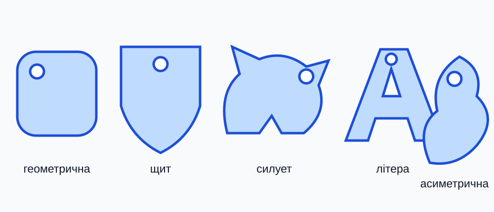
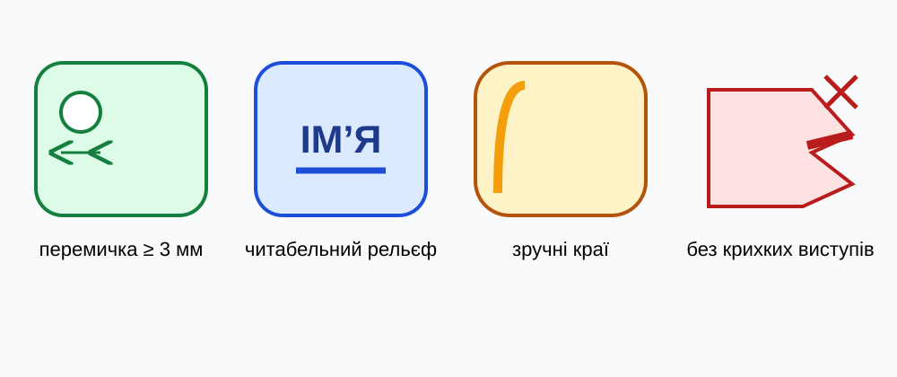

# Практична робота 2. Авторський брелок

## Тема

Творче проєктування брелока довільної форми засобами Fusion із використанням витягування, вирізання, отворів, фасок, скруглень, написів та імпорту SVG за матеріалами [уроків 6–9](../../Уроки/less-06/README.md).

## Орієнтовний загальний час виконання

45–60 хвилин. Розроблення власного логотипа для творчого 12-го бала може бути завершене до початку 3D-моделювання.

## Мета роботи та вміння

Створити власний брелок, у якому форма, напис і декоративні елементи утворюють цілісну композицію. Перевіряються вміння планувати послідовність побудови, створювати й редагувати об’єм, використовувати Join і Cut, забезпечувати міцність ділянки біля отвору та оцінювати потенційну зручність і довговічність виробу.

## Завдання

Розробіть брелок довільної форми. Це може бути геометрична фігура, силует предмета, літера, емблема, тварина або власна абстрактна композиція. Брелок повинен мати наскрізний отвір або вушко для кільця, читабельний напис і доречно оброблені краї.

*Рисунок 1. Приклади напрямів пошуку форми: геометрична пластина, щит, силует, літера та асиметрична композиція. Це не готові шаблони для копіювання.*

Форма має бути авторським рішенням учня або учениці. Схеми на рисунку 1 допомагають оцінити пропорції, але не визначають обов’язковий контур.

## Вихідні дані та технічні вимоги

| Елемент | Обов’язкова вимога |
| --- | --- |
| Форма | довільна, але замкнена, цілісна й придатна до виготовлення |
| Габарити | найбільший розмір 45–80 мм; товщина основи 3–5 мм |
| Напис | короткий текст, ініціали або ім’я; читабельний і розміщений у межах основи |
| Рельєф | виступ або заглиблення напису 0,6–1,5 мм |
| Кріплення | наскрізний отвір ⌀4–6 мм або вушко з таким отвором |
| Перемичка | не менше 3 мм матеріалу від краю отвору до зовнішнього краю |
| Обробка | щонайменше одне доречне скруглення та одна фаска |
| Результат | одне цілісне тіло без відокремлених літер і декоративних фрагментів |

Для створення форми й оздоблення дозволено використовувати **Extrude**, **Join**, **Cut**, отвори, **Fillet**, **Chamfer**, текстові ескізи та **Insert SVG**. Готовий SVG дозволено використати як декоративний елемент, але потрібно вказати його джерело й умови використання. Імпортований знак не повинен замінювати самостійне моделювання основи.

## Технологічність брелока

Оцінюється не лише зовнішній вигляд, а й потенційна придатність виробу до щоденного використання.

*Рисунок 2. Перевірка технологічності: достатня перемичка біля отвору, читабельний рельєф, зручні краї та відсутність крихких виступів.*

Брелок має бути зручним у руці, не мати невиправдано гострих кутів і дуже тонких виступів. Отвір не можна розміщувати в слабкій вузькій ділянці. Напис і логотип не повинні створювати окремих елементів, які легко відламаються. Надмірно глибоке вирізання послаблює основу, а занадто дрібний рельєф може бути нерозбірливим після виготовлення.

## Послідовність виконання

1. Визначте призначення, тему, напис і загальну форму брелока. Зробіть у Fusion простий ескіз композиції та перевірте, чи вистачає місця для отвору, тексту й декоративних елементів.
2. Побудуйте замкнений контур основи та задайте основні габарити. Для симетричної форми використайте вісь і дзеркальне відображення. Витягніть основу на 3–5 мм як **New Body**.
3. Створіть отвір ⌀4–6 мм командою Hole або наскрізним **Extrude → Cut**. Виміряйте перемичку від краю отвору до зовнішнього контуру: вона має бути не меншою за 3 мм після обробки ребер.
4. На верхній грані додайте текст. Оберіть шрифт із достатньою товщиною штрихів, налаштуйте розмір і положення. Створіть виступ або заглиблення 0,6–1,5 мм і переконайтеся, що всі потрібні профілі літер оброблено.
5. За бажанням вставте дозволений готовий SVG. Відмасштабуйте його, перевірте замкнутість профілів і виконайте Join або неглибокий Cut. Зазначте джерело SVG у звіті.
6. Для творчого 12-го бала самостійно створіть особистий логотип в Inkscape або CorelDRAW, збережіть його як SVG, вставте у Fusion і використайте в геометрії брелока. Логотип повинен бути оригінальним, а не перемальованим готовим знаком.
7. Додайте скруглення до країв, яких торкатиметься рука, та фаску біля отвору або на іншому виправданому ребрі. Значення доберіть так, щоб операції не руйнували тонкі ділянки.
8. Огляньте брелок зверху, знизу й у перспективі. Перевірте габарити, товщину, наскрізність отвору, цілісність тіла, читабельність напису та відсутність помилок на шкалі історії.

## Матеріали для перевірки

Подайте один звіт у форматі **Microsoft Word (`.docx`) або PDF**. Файл моделі подавати не потрібно. У звіті мають бути назва роботи, короткий опис задуму, фактичні розміри, послідовні докази виконання, таблиця вимог і висновок про технологічність брелока.

## Вимоги до звіту

Додайте пронумеровані скріншоти в послідовності виконання роботи: ескіз основи з розмірами, витягнута основа, отвір із розміром і перемичкою, створення напису, SVG за наявності, фаски й скруглення, повний результат. Під кожним скріншотом напишіть короткий змістовний підпис. Останній скріншот має показувати весь готовий брелок у зручному масштабі.

**У звіт додаються саме скріншоти виконання роботи у відповідних програмах. Не схеми, не ескізи від руки, не згенеровані зображення. Такі матеріали не замінюють скріншоти етапів виконання.**

На скріншотах мають читатися геометрія, розміри та параметри операцій. Не використовуйте фотографії монітора. Для перевірки заповніть таблицю:

| Вимога | Виконано | Доказ |
| --- | --- | --- |
| Назва конкретної вимоги | Так / частково / ні | № відповідного скріншота |

Якщо використано готовий SVG, укажіть його назву, автора або сайт, посилання та ліцензію. Якщо SVG не використано, так і зазначте.

Для 12-го бала додайте скріншоти створення особистого логотипа в Inkscape або CorelDRAW, його векторних контурів та результату імпорту у Fusion. Окремим текстом поясніть задум логотипа, назвіть використані інструменти та опишіть, як знак пов’язаний із дизайном брелока. Без цих скріншотів і текстового обґрунтування творчий бал не нараховується.

## Критерії оцінювання

| Критерій | Максимум балів |
| --- | ---: |
| Авторська форма, правильні габарити та цілісне тіло | 2 |
| Наскрізний отвір і перемичка не менше 3 мм | 2 |
| Читабельний напис із коректним рельєфом | 2 |
| Доречні фаски, скруглення та інші операції | 1 |
| Технологічність: зручність, міцність і довговічність | 2 |
| Послідовний звіт Word/PDF зі скріншотами й таблицею доказів | 2 |
| **Разом за обов’язкові вимоги** | **11** |
| Власний логотип, створений в Inkscape або CorelDRAW, імпортований як SVG та обґрунтований у звіті | 1 |
| **Разом** | **12** |

**Якщо особистого логотипа немає або використано готовий SVG, максимальна оцінка за роботу — 11 балів.** Власний логотип не компенсує порушення обов’язкових технічних вимог. Формальна зміна кольору, напису чи масштабу готового знака не вважається розробленням особистого логотипа.

## Правила самостійного виконання та дозволені джерела

Модель і власний логотип виконуйте самостійно. Дозволено користуватися матеріалами уроків, офіційною довідкою Fusion, Inkscape або CorelDRAW та SVG із відкритою ліцензією. Не видавайте чужий знак або готову модель за власну роботу.

[Текст в ескізах — Autodesk](https://help.autodesk.com/view/fusion360/ENU/?contextId=SKT-SKETCH-CREATE-TEXT) · [Insert SVG — Autodesk](https://help.autodesk.com/cloudhelp/ENU/Fusion-Model/files/SLD-INS-SVG.htm)

[До переліку практичних робіт](../README.md) · [До тематичного плану](../../README.md)
