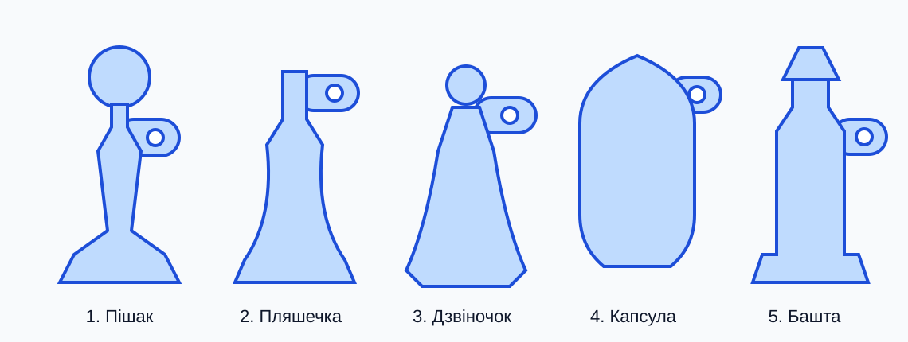
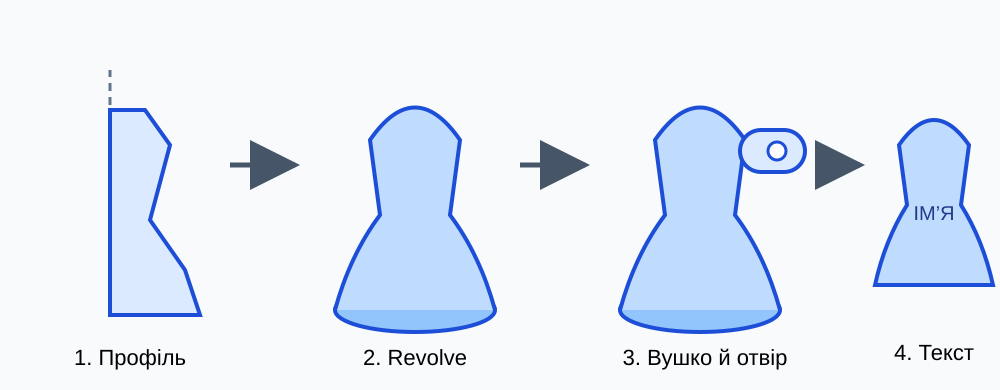
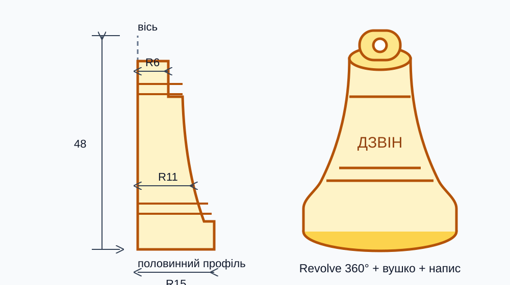
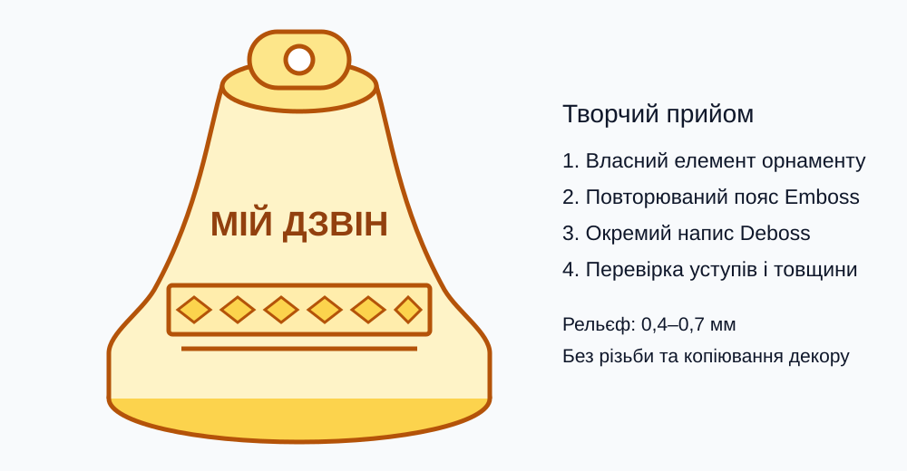

# Практична робота 4. Авторський брелок на основі тіла обертання

## Тема

Створення авторської основи брелока командою Revolve та її доповнення вивченими операціями: Extrude, Join, Cut, Hole, Fillet, Chamfer, імпортом SVG і текстом. Робота виконується за матеріалами [уроків 10–11](../../Уроки/less-10/README.md).

## Орієнтовний загальний час виконання

45–60 хвилин.

## Мета роботи та вміння

Навчитися перетворювати половинний профіль на осесиметричне тіло й поєднувати Revolve з відомими операціями. Перевіряються профіль, вісь, габарити, цілісність, надійність вушка та читабельність персоналізації.

Різьба в цій роботі не використовується: команда Thread і правила різьбових з’єднань ще не вивчалися.

## Завдання

Створіть брелок, головна основа якого отримана повним обертанням замкненого профілю. Оберіть один із п’яти напрямів або запропонуйте власну осесиметричну форму: пішак чи навершник, мініпляшечка, дзвіночок, капсула, башта чи маяк.

*Рисунок 1. П’ять напрямів для авторської роботи. Силует, пропорції, вушко й оздоблення потрібно розробити самостійно.*

Шахова фігура не має переваги в оцінюванні. Змініть щонайменше три пропорції або характерні ділянки обраного профілю.

## Технічні вимоги

| Елемент | Обов’язкова вимога |
| --- | --- |
| Основна форма | Revolve 360° із замкненого визначеного профілю |
| Габарити | висота 35–70 мм; найбільший діаметр 18–32 мм |
| Опорна або кінцева грань | без небезпечного вістря; плоска, якщо виріб має стояти |
| Вушко | приєднане операцією Join; перекриття з основою не менше 3 мм |
| Отвір | наскрізний ⌀4–6 мм; перемичка до краю не менше 3 мм |
| Обробка | щонайменше одне доречне скруглення та одна фаска |
| Персоналізація | короткий напис, готовий SVG або власний логотип із практичної роботи 2 |
| Текст | на плоскій грані, уздовж кривої або через Emboss/Deboss на придатній криволінійній поверхні |
| Результат | одне цілісне тіло без різьби й відокремлених деталей |

Дозволено всі попередні операції та Revolve. Основний об’єм створюють обертанням, а додаткові елементи — Extrude, Join, Cut, Hole, Fillet, Chamfer, Text та Insert SVG.

*Рисунок 2. Загальний робочий процес: профіль, Revolve, приєднане вушко з отвором і персоналізація.*

## Навчальний приклад: брелок-дзвін

У зображенні дзвона виділяємо широку нижню крайку, плавне звуження, кільцеві уступи та верхню шийку. Корону, язик і дрібний декор не моделюємо.

*Рисунок 3. Приклад спрощення дзвона до половинного профілю Revolve; усі розміри наведено в міліметрах.*

| Параметр дзвона | Значення |
| --- | ---: |
| Загальна висота тіла | 48 мм |
| Найбільший діаметр нижньої крайки | 30 мм |
| Діаметр середньої частини | 22 мм |
| Діаметр верхньої шийки | 12 мм |
| Висота нижньої крайки | 6 мм |
| Вушко | 16 × 12 × 6 мм |
| Отвір | ⌀5 мм |

1. На вертикальній площині проведіть вісь Construction. Праворуч від неї побудуйте половину зовнішнього силуету: нижню крайку R15, плавний корпус до R11 і шийку R6. Замкніть профіль уздовж осі.
2. Задайте висоту 48 мм, крайку 6 мм та два невеликі уступи. Для плавного корпусу використайте дотичну дугу або сплайн із малою кількістю точок. Не додавайте різьбоподібних канавок.
3. Виконайте Revolve 360° як New Body. Перевірте ⌀30 унизу, ⌀22 посередині та плоску нижню грань.
4. На вертикальній площині побудуйте вушко 16 × 12 мм із перекриттям шийки не менше 3 мм. Витягніть симетрично на 6 мм з Join.
5. Виріжте у вушку отвір ⌀5 мм Through All. Додайте фаску 0,5 мм біля отвору та Fillet R1–R2 на зовнішньому переході.
6. Нанесіть короткий напис на широкий плавний пояс через Emboss/Deboss або розмістіть Text on Path на плоскій нижній крайці.

Розміри є прикладом; пропорції можна змінювати в межах загальних вимог.

## Послідовність власного варіанта

1. Оберіть образ, габарити, місце вушка та спосіб персоналізації.
2. Створіть визначений половинний профіль з одного боку осі, використовуючи відрізки, дотичні дуги або сплайн. Не додавайте різьбу.
3. Виконайте Revolve 360° як New Body та перевірте висоту й діаметр через Measure.
4. Побудуйте вушко з перекриттям не менше 3 мм, витягніть його з Join і виріжте отвір ⌀4–6 мм Through All.
5. Перевірте перемичку 3 мм, додайте доречні Chamfer і Fillet та переконайтеся, що в браузері залишилося одне тіло.

### Персоналізація

Оберіть один обов’язковий спосіб: звичайний текст або SVG на плоскій грані; Text on Path уздовж плоскої дуги; Emboss/Deboss 0,5–0,8 мм на придатній радіусній поверхні. Для Emboss потрібен не однолінійний шрифт. Якщо складна поверхня не перебудовується, перенесіть напис на простішу ділянку.

## Приклад творчого 12-го бала: декоративний пояс

За мотивами зображення створіть власний повторюваний візерунок або напис, не копіюючи історичний декор.

*Рисунок 4. Авторський геометричний пояс Emboss і напис Deboss на радіусній поверхні навчального дзвона.*

1. Створіть елемент орнаменту: ромб, хвилю, листок або поєднання дуг.
2. Сформуйте ряд повторів або власний SVG і розташуйте пояс на широкій ділянці корпусу.
3. Застосуйте Emboss 0,4–0,7 мм; окремий короткий напис можна виконати Deboss 0,4–0,6 мм.
4. Перевірте, що рельєф не перетинає уступи та не створює крихких деталей.
5. У звіті покажіть ескіз, параметри Emboss/Deboss і близький вигляд результату; поясніть користь прийому.

Творчий бал нараховується лише за новий корисний прийом, підтверджений текстом і скріншотами. Звичайний напис входить до обов’язкових 11 балів.

### Остаточна перевірка

Перевірте габарити, отвір, перемичку, цілісність, відсутність гострих крихких виступів і помилок на шкалі історії. Змініть один керувальний розмір профілю, перевірте перебудову й поверніть потрібне значення.

Переконайтеся, що напис читається, не перетинає отвір і не потрапляє на вузький перехід. У готовій моделі не повинно бути різьби.

## Вимоги до звіту

Подайте звіт Word або PDF із пронумерованими скріншотами профілю, Revolve, вушка, отвору, обробки країв, персоналізації та повного результату. Файл моделі не потрібний.

Під кожним скріншотом назвіть дію, важливі параметри й отриманий результат. Останній скріншот має показувати весь брелок у перспективі. Для тексту на криволінійній поверхні додайте окремий близький вигляд.

**У звіт додаються саме скріншоти виконання роботи у Fusion. Не схеми, не ескізи від руки, не згенеровані зображення. Такі матеріали не замінюють скріншоти етапів виконання.**

## Критерії оцінювання

| Критерій | Максимум балів |
| --- | ---: |
| Авторський визначений профіль і правильна вісь | 2 |
| Коректне Revolve 360° та дотримання габаритів | 2 |
| Надійне вушко, наскрізний отвір і перемичка | 2 |
| Доречні фаска, скруглення та цілісність тіла | 2 |
| Читабельний напис або SVG, правильно нанесений на обрану поверхню | 1 |
| Послідовний звіт зі скріншотами й підписами | 2 |
| **Разом за обов’язкові вимоги** | **11** |
| Доречний творчий прийом поза матеріалами уроків із обґрунтуванням і скріншотом | 1 |
| **Разом** | **12** |

Для 12-го бала назвіть новий прийом і поясніть його вплив на модель. Формальна додаткова команда не зараховується.

## Правила самостійного виконання та дозволені джерела

Виконуйте профіль і модель самостійно. Дозволено користуватися уроками 10–11, офіційною довідкою Autodesk, власним SVG із практичної роботи 2 або SVG із відкритою ліцензією. Не копіюйте готову модель і не використовуйте різьбу.

[Revolve — Autodesk](https://help.autodesk.com/cloudhelp/ENU/Fusion-Model/files/SLD-REVOLVE-SOLID.htm) · [Text on Path — Autodesk](https://help.autodesk.com/cloudhelp/ENU/Fusion-Sketch/files/SKT-REF-TEXT-DIALOG.htm) · [Emboss — Autodesk](https://help.autodesk.com/view/fusion360/ENU/?contextId=SLD-EMBOSS)

[До переліку практичних робіт](../README.md) · [До тематичного плану](../../README.md)
