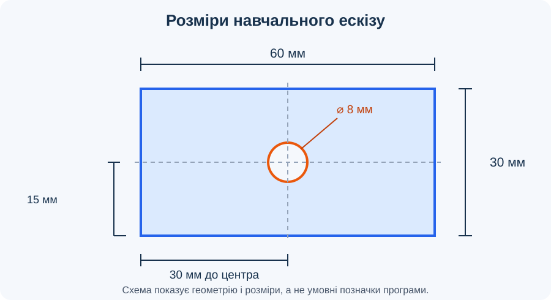
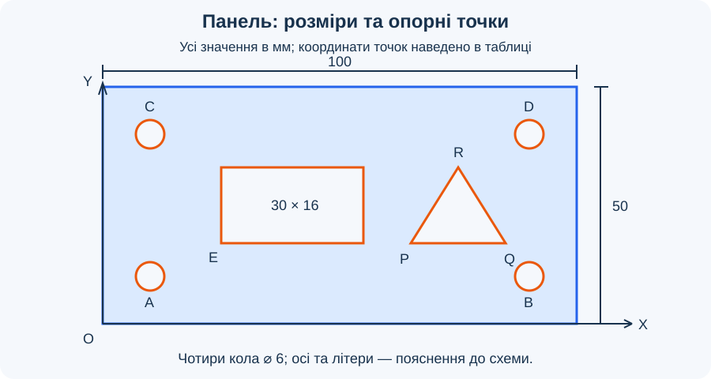
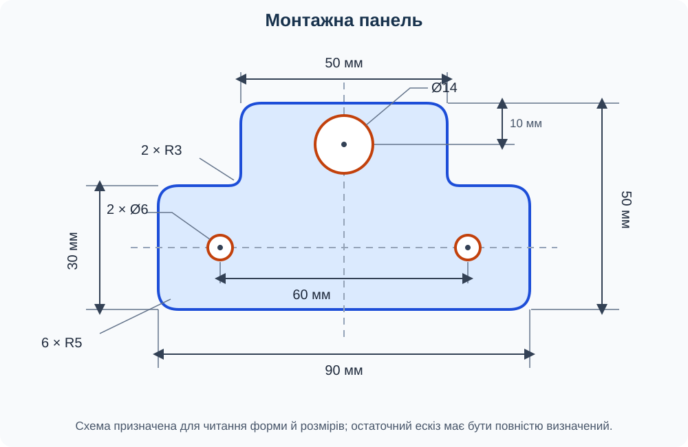

# Урок 5. Геометричні обмеження та розміри

## Мета

Навчитися керувати формою й положенням ескізу за допомогою геометричних обмежень і числових розмірів.

## Геометричні обмеження

*Рисунок 1. Навчальний приклад нанесення розмірів на ескіз пластини.*

Обмеження задають відношення між елементами ескізу. Розміри визначають числові значення, наприклад довжину сторони або діаметр кола.

| Обмеження | Що забезпечує |
| --- | --- |
| Горизонтальність / вертикальність | Напрямок відрізка |
| Збіг | Спільне положення точок або точки на кривій |
| Рівність | Однаковий розмір вибраних елементів |
| Паралельність | Однаковий напрямок прямих |
| Перпендикулярність | Прямий кут між прямими |
| Концентричність | Спільний центр кіл або дуг |

**Повністю визначений ескіз** не має вільного переміщення чи зміни розміру: його форму й положення визначають обмеження та розміри. Якщо після додавання нового обмеження виникає помилка, перевірте, чи не дублює воно вже задані умови.

## Тренувальний ескіз

Доведіть ескіз «Панель» з [уроку 4](../less-04/README.md) до повного визначення. Збережіть сім контурів: зовнішній прямокутник, чотири кола, прямокутне вікно та трикутник. Рисунок 1 залишається простим вступним прикладом; для тренувальної вправи використовуйте **рисунок 2 і таблицю нижче**. Це авторські навчальні розміри.

*Рисунок 2. Тренувальна панель 100 × 50 мм. Позначення точок відповідають таблиці; літери й осі на схемі не потрібно додавати до ескізу.*

Початок O сумістіть із нижньою лівою вершиною панелі; X спрямована праворуч, Y — угору. Координати в таблиці означають горизонтальні та вертикальні відстані від O, а не довжину похилого відрізка між точками.

| Елемент | Розмір або положення |
| --- | --- |
| Зовнішній прямокутник | Ширина 100, висота 50; нижня ліва вершина в O |
| Чотири кола A, B, C, D | Однаковий діаметр 6 |
| Центри A і B, нижній ряд | A: (10; 10), B: (90; 10) |
| Центри C і D, верхній ряд | C: (10; 40), D: (90; 40) |
| Прямокутне вікно | Ширина 30, висота 16; нижня ліва вершина E: (25; 17) |
| Трикутник PQR | P: (65; 17), Q: (85; 17), R: (75; 33) |

Не дублюйте всі координати окремими розмірами, якщо положення вже визначене зв’язками. Наприклад, однакова висота A і B задається горизонтальним вирівнюванням їхніх центрів.

## Тренувальний розбір

У готовому ескізі уроку 4 перевірте збіг кінців і прив’яжіть нижній лівий кут до початку координат. Задайте габарити панелі, діаметр кола A, а решту діаметрів визначте через Equal. Вирівняйте центри горизонтально й вертикально. Задайте положення рядів, вікна й трикутника за таблицею.

Змініть діаметр A з 6 на 8 мм: усі чотири отвори мають змінитися. Поверніть 6 мм. Якщо під час зміни ширини зі 100 на 110 мм потрібно зберегти правий відступ 10 мм, прив’яжіть центр B до правої сторони замість задання його координати X. Після досліду поверніть ширину 100 мм. Перевірте, чи ескіз повністю визначений.

## Практична робота № 1

**Ескіз монтажної панелі**

### Час і мета

20–30 хвилин. Створіть замкнений симетричний контур і задайте геометричні обмеження, скруглення та розміри, потрібні для повного визначення ескізу.

### Завдання

Самостійно створіть ескіз симетричної монтажної панелі з верхнім виступом і трьома отворами.

*Рисунок 3. Розмірна схема деталі. Позначення R задає радіус скруглення, Ø — діаметр отвору.*

### Розміри та геометрія

#### Зовнішній контур

- загальна ширина — **90 мм**;
- загальна висота — **50 мм**;
- висота нижньої прямокутної частини — **30 мм**;
- ширина верхнього виступу — **50 мм**;
- верхній виступ розташований симетрично відносно вертикальної осі деталі;
- шість зовнішніх опуклих кутів мають скруглення **R5 мм**;
- два внутрішні кути біля основи виступу мають скруглення **R3 мм**.

#### Отвори

- два нижні монтажні отвори мають діаметр **6 мм**;
- центри монтажних отворів лежать на горизонтальній осі нижньої частини;
- відстань між центрами монтажних отворів — **60 мм**;
- центральний отвір у верхньому виступі має діаметр **14 мм**;
- центр отвору Ø14 мм лежить на вертикальній осі симетрії та розташований на **10 мм** нижче верхнього краю деталі.

Початок координат розташуйте в центрі нижньої прямокутної частини. Горизонтальна й вертикальна допоміжні осі мають проходити через початок координат.

### Послідовність виконання

1. Відкрийте окремий ескіз практичної роботи, розпочатий на уроці 4, або створіть новий. Проведіть дві допоміжні осі через початок координат.
2. Побудуйте нижній прямокутник 90 × 30 мм і симетричний виступ 50 × 20 мм. Обріжте спільну ділянку командою Trim. Додайте шість скруглень R5 і два R3.
3. Задайте перший отвір Ø6 мм. Другий створіть дзеркальним відображенням або обмеженнями симетрії та рівності. Розмістіть центри на горизонтальній осі на відстані 60 мм один від одного.
4. Задайте отвір Ø14 мм на вертикальній осі за 10 мм від верхнього краю. Додайте відсутні зв’язки й розміри та перевірте нерухомість геометрії перетягуванням.

### Що подати на перевірку

- звіт про виконання роботи у форматі Markdown або PDF.

Для оформлення використайте [макет звіту](../../Практичні/report-template/README.md). Замініть приклади в макеті власними скріншотами виконання роботи.

### Вимоги до звіту

Додайте послідовні пронумеровані скріншоти зі змістовними підписами. У підписах поясніть дію, параметри та результат. На останньому скріншоті покажіть повний ескіз із читабельними розмірами й обмеженнями.

Для 12-го бала окремо назвіть використаний прийом, поясніть, чому його не охоплювали уроки 4–5 та як він покращив роботу. Укажіть номер скріншота. Без обґрунтування творчий бал не нараховується.

### Критерії оцінювання

| Складник роботи | Бали |
| --- | ---: |
| Побудовано правильний симетричний зовнішній контур із виступом; зайві лінії обрізано | 2 |
| Загальні розміри, розміри нижньої частини та виступу відповідають завданню | 1 |
| Виконано шість скруглень R5 мм і два скруглення R3 мм | 2 |
| Побудовано три отвори правильних діаметрів | 1 |
| Отвори правильно розташовано відносно осей, країв та один одного | 2 |
| Застосовано доцільні допоміжні осі й геометричні обмеження; ескіз повністю визначений | 2 |
| Звіт подано у визначеному форматі; він містить послідовні скріншоти зі змістовними підписами та повний фінальний результат | 1 |
| Творчо й доречно використано можливість Fusion, якої не розглядали на уроках 4–5; її застосування пояснено у звіті та показано на скріншоті | 1 |
| **Разом** | **12** |

Якщо ескіз не є повністю визначеним, але геометрія, розміри й положення елементів правильні, за складник із повним визначенням може бути нараховано **1 бал із 2**.

### Правила самостійного виконання

Виконуйте роботу індивідуально. Дозволено користуватися матеріалами [уроку 4](../../Уроки/less-04/README.md) та [уроку 5](../../Уроки/less-05/README.md). Готові файли інших учнів використовувати не можна.

## Довідка

- [Геометричні обмеження — Autodesk](https://help.autodesk.com/cloudhelp/ENU/Fusion-Sketch/files/SKT-CONSTRAINTS.htm).
- [Нанесення розмірів — Autodesk](https://help.autodesk.com/view/fusion360/ENU/?contextId=SKT-CREATE-DIMENSIONS).
- [Повне визначення ескізу — Autodesk](https://help.autodesk.com/cloudhelp/ENU/Fusion-Sketch/files/SKT-FULLY-DEFINE-CONSTRAIN-SKETCH.htm).

[До тематичного плану](../../README.md) · [Попередній урок](../less-04/README.md) · [Наступний урок](../less-06/README.md)
