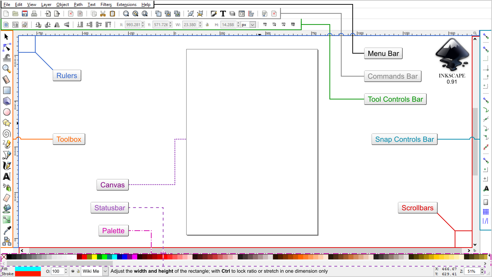
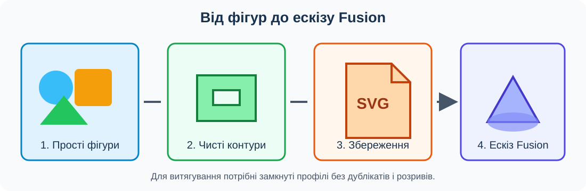

# Урок 6. Векторна графіка. Логотип в Inkscape

## Мета та результат

Навчитися створювати простий векторний знак, перевіряти його контури та готувати SVG для вставлення в Autodesk Fusion. Наприкінці уроку учень або учениця має власний логотип, пробний імпорт у Fusion і початок звіту [практичної роботи 1](../../Практичні/pract-01/README.md). Об’ємний брелок буде завершено на уроці 7.

## Інтерфейс Inkscape

*Рисунок 1. Основні частини інтерфейсу Inkscape 0.91. У новішій версії розташування окремих елементів може відрізнятися.*

Зліва розташована панель інструментів малювання, угорі — меню та параметри активного інструмента, у центрі — сторінка документа, унизу — палітра кольорів. Інструмент Selector дає змогу вибирати, переміщувати й масштабувати об’єкти; Node редагує вузли контуру.

Скріншот створив Vwanweb; джерело — [Wikimedia Commons](https://commons.wikimedia.org/wiki/File:Inkscape_User_Interface.png), ліцензія [CC BY-SA 4.0](https://creativecommons.org/licenses/by-sa/4.0/). Зображення не змінено.

## Від зображення до геометрії

Растрове зображення складається з пікселів. Під час значного збільшення його краї можуть ставати нерівними. Векторне зображення описує фігури математично: вузлами, відрізками й кривими. Його можна масштабувати без втрати чіткості.

SVG — відкритий формат масштабованої векторної графіки. Fusion вставляє SVG як геометрію ескізу. Видимий малюнок ще не гарантує придатність до моделювання: для наступного витягування потрібні замкнуті профілі без розривів, випадкових дублікатів і самоперетинів.

**Заливка** показує внутрішню область форми, а **обведення** — лінію вздовж її краю. Товсте обведення не завжди перетворюється на очікувану область після імпорту. Якщо ширина штриха має бути реальною частиною знака, застосуйте **Path → Stroke to Path**. Текст перед передаванням на інший комп’ютер перетворюють через **Path → Object to Path**, щоб результат не залежав від наявного шрифту.

| Інструмент | Призначення | Що перевірити |
| --- | --- | --- |
| Selector | Вибір, переміщення та масштабування | Положення й кінцевий розмір знака |
| Rectangle | Прямокутники та заокруглені прямокутники | Чи не залишилося випадкової обводки |
| Ellipse | Кола, еліпси та дуги | Чи форма замкнута, а не перетворена на дугу |
| Stars and Polygons | Зірки та багатокутники | Кількість кутів і товщина вузьких частин |
| Text | Короткий напис | Перетворення на контури у версії для Fusion |
| Node | Перевірка й редагування вузлів | Розриви, накладені сегменти та зайві вузли |

## Послідовність підготовки SVG

*Рисунок 2. Робочий процес: прості фігури утворюють чисті контури, які зберігаються в SVG та вставляються в ескіз Fusion.*

## Хід уроку

### 1. Підготовка документа

Створіть новий документ Inkscape та встановіть міліметри як одиниці. Збережіть його під назвою `Логотип-вихідний.svg`. Робочий знак для брелка має вміститися в поле 20 × 20 мм, тому відразу контролюйте його габарити, а не лише вигляд на збільшеному екрані.

Побудуйте окремо прямокутник, коло та багатокутник. Перемістіть, масштабуйте й вирівняйте їх. Змініть заливку та відкрийте Fill and Stroke, щоб побачити різницю між заливкою й обведенням.

### 2. Створення власного знака

Складіть знак із двох або трьох простих фігур. Він має залишатися читабельним після зменшення. Не використовуйте дрібні проміжки, велику кількість гострих променів або складний орнамент: такі елементи утворюють багато вузлів і ускладнюють ескіз Fusion.

Якщо елементи мають стати одним силуетом, застосуйте потрібну логічну операцію над контурами після збереження вихідної копії. Якщо всередині потрібен отвір, залиште окремий замкнутий контур, який не торкається зовнішнього. Деталі знака повинні бути не меншими за 0,5 мм, а штрихи — не вужчими за 0,8 мм у кінцевому масштабі відповідно до практичної роботи.

За бажанням додайте короткий напис. Перед підготовкою версії для Fusion перетворіть його на контури. Після цього текст уже не редагується звичайним інструментом Text, тому не замінюйте ним вихідний файл.

### 3. Перевірка контурів

Створіть копію `Логотип-Fusion.svg`. Інструментом Node огляньте зовнішні й внутрішні контури. Видаліть об’єкти поза сторінкою, випадкові дублікати й непотрібні вузли. Залиште лише геометрію, яка має потрапити до ескізу.

Збільште кожне місце з’єднання. Візуально близькі кінці кривої можуть залишатися розімкненими. Якщо знак складається з відокремлених областей, кожна з них повинна бути замкнутою й мати достатню товщину.

### 4. Пробний імпорт у Fusion

У Fusion створіть документ «Брелок — логотип» і ескіз «Проба SVG» на площині XY. Виконайте **Insert → Insert SVG**, виберіть підготовлений файл, задайте положення й масштаб. Офіційна довідка Autodesk вказує, що Insert SVG вставляє файл в активний ескіз і дає змогу налаштувати зміщення, кут, віддзеркалення та масштаб.

Після підтвердження перевірте фактичну ширину знака та можливість вибирати його замкнуті області. Якщо область не розпізнається, поверніться до Inkscape й знайдіть розрив або зайву геометрію. Не вставляйте багато виправлених копій в один ескіз: видаліть невдалий імпорт або створіть чистий пробний ескіз.

### 5. Фіксація результату

Завершіть пробний ескіз, приховайте його й збережіть документ. До звіту практичної роботи додайте пронумерований скріншот логотипу в Inkscape та скріншот імпорту у Fusion із видимим розміром. Під кожним зображенням поясніть, що перевірено. Об’єм на цьому уроці не створюйте.

## Завдання

Виконайте розділ **«Урок 6. Логотип та підготовка SVG»** у [практичній роботі 1](../../Практичні/pract-01/README.md): створіть власний знак, підготуйте чистий SVG, вставте його в пробний ескіз Fusion та перевірте масштаб і замкнуті області.

## Типові помилки

- До SVG вставлено растрове зображення замість векторних контурів.
- Знак виглядає правильно лише завдяки товстому обведенню.
- Текст не перетворено на контури й замінюється іншим шрифтом.
- Після логічної операції залишилися дублікати або самоперетини.
- Під час повторного імпорту кілька копій SVG наклалися одна на одну.
- Розмір оцінено «на око», без вимірювання у Fusion.

## Перевірка результату

- Логотип складається з власних векторних фігур і має щонайменше один замкнутий контур.
- Підготовлена версія не містить вкладеного растрового зображення.
- Текст і потрібні обведення перетворено на контури.
- Деталі відповідають мінімальним розмірам практичної роботи.
- SVG вставляється у Fusion, а потрібні області розпізнаються як профілі.
- У звіті є підписані скріншоти етапу Inkscape та пробного імпорту.

## Довідка

- [Фігури в Inkscape — офіційний навчальний матеріал](https://inkscape.org/doc/tutorials/shapes/tutorial-shapes.html).
- [Вставлення SVG у Fusion — офіційна довідка Autodesk](https://help.autodesk.com/cloudhelp/ENU/Fusion-Model/files/SLD-INS-SVG.htm).

[До тематичного плану](../../README.md) · [Попередній урок](../less-05/README.md) · [Наступний урок](../less-07/README.md)
