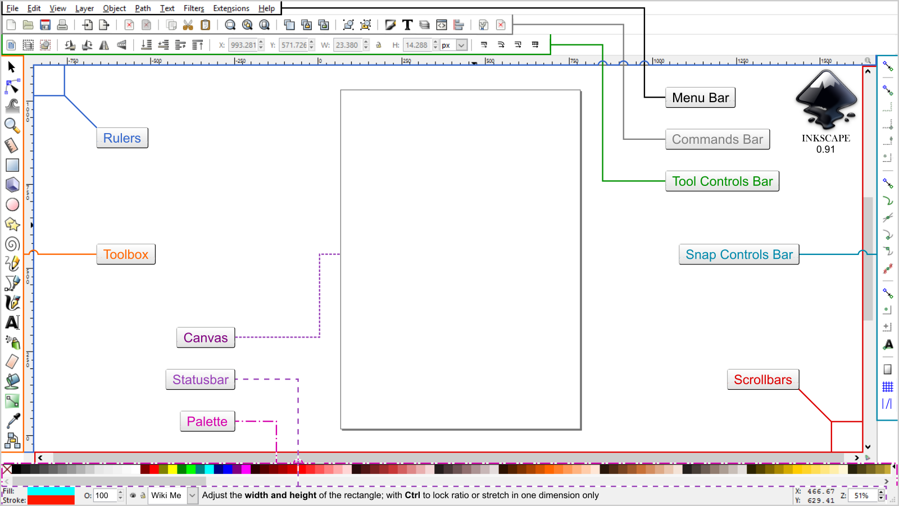
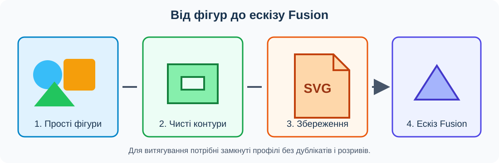
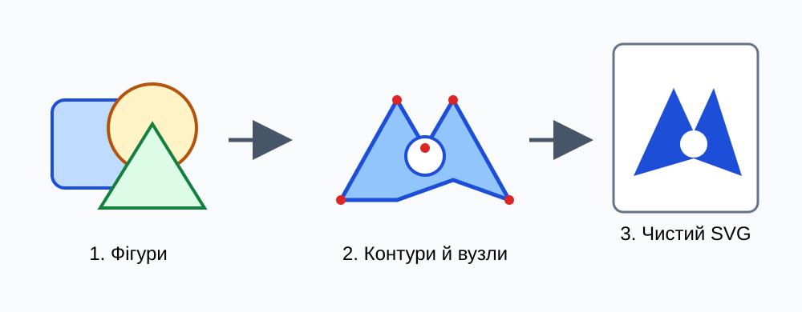

# Урок 6. Векторна графіка. Логотип в Inkscape

## Мета та результат

Навчитися створювати простий векторний знак, перевіряти його контури та готувати чистий SVG. Наприкінці уроку учень або учениця має власний логотип і завершений звіт [практичної роботи 2](#практична-робота--2). Пробний імпорт у Fusion демонструє придатність контурів до моделювання.

## Інтерфейс Inkscape

*Рисунок 1. Основні частини інтерфейсу Inkscape 0.91. У новішій версії розташування окремих елементів може відрізнятися.*

Зліва розташована панель інструментів малювання, угорі — меню та параметри активного інструмента, у центрі — сторінка документа, унизу — палітра кольорів. Інструмент Selector дає змогу вибирати, переміщувати й масштабувати об’єкти; Node редагує вузли контуру.

Скріншот створив Vwanweb; джерело — [Wikimedia Commons](https://commons.wikimedia.org/wiki/File:Inkscape_User_Interface.png), ліцензія [CC BY-SA 4.0](https://creativecommons.org/licenses/by-sa/4.0/). Зображення не змінено.

## Від зображення до геометрії

Растрове зображення складається з пікселів. Під час значного збільшення його краї можуть ставати нерівними. Векторне зображення описує фігури математично: вузлами, відрізками й кривими. Його можна масштабувати без втрати чіткості.

SVG — відкритий формат масштабованої векторної графіки. Fusion вставляє SVG як геометрію ескізу. Видимий малюнок ще не гарантує придатність до моделювання: для наступного витягування потрібні замкнуті профілі без розривів, випадкових дублікатів і самоперетинів.

**Заливка** показує внутрішню область форми, а **обведення** — лінію вздовж її краю. Товсте обведення не завжди перетворюється на очікувану область після імпорту. Якщо ширина штриха має бути реальною частиною знака, застосуйте **Path → Stroke to Path**. Текст перед передаванням на інший комп’ютер перетворюють через **Path → Object to Path**, щоб результат не залежав від наявного шрифту.

| Інструмент | Призначення | Що перевірити |
| --- | --- | --- |
| Selector | Вибір, переміщення та масштабування | Положення й кінцевий розмір знака |
| Rectangle | Прямокутники та заокруглені прямокутники | Чи не залишилося випадкової обводки |
| Ellipse | Кола, еліпси та дуги | Чи форма замкнута, а не перетворена на дугу |
| Stars and Polygons | Зірки та багатокутники | Кількість кутів і товщина вузьких частин |
| Text | Короткий напис | Перетворення на контури у версії для Fusion |
| Node | Перевірка й редагування вузлів | Розриви, накладені сегменти та зайві вузли |

## Послідовність підготовки SVG

*Рисунок 2. Робочий процес: прості фігури утворюють чисті контури, які зберігаються в SVG та вставляються в ескіз Fusion.*

## Пробний імпорт у Fusion

У Fusion створіть документ «Брелок — логотип» і ескіз «Проба SVG» на площині XY. Виконайте **Insert → Insert SVG**, виберіть підготовлений файл, задайте положення й масштаб. Офіційна довідка Autodesk вказує, що Insert SVG вставляє файл в активний ескіз і дає змогу налаштувати зміщення, кут, віддзеркалення та масштаб.

Після підтвердження перевірте фактичну ширину знака та можливість вибирати його замкнуті області. Якщо область не розпізнається, поверніться до Inkscape й знайдіть розрив або зайву геометрію. Не вставляйте багато виправлених копій в один ескіз: видаліть невдалий імпорт або створіть чистий пробний ескіз.

## Практична робота № 2

**Власний логотип в Inkscape**

### Час і мета

40–45 хвилин. Скомпонуйте векторні фігури, відредагуйте вузли, перевірте замкненість і габарити та підготуйте чистий SVG.

### Завдання

Створіть в Inkscape власний логотип, який передає обрану ідею, інтерес, ініціали або умовний образ. Знак має залишатися впізнаваним у малому розмірі, складатися з векторних контурів і не бути копією готового логотипа.

*Рисунок 3. Від ідеї та простих фігур до чистого контуру й готового SVG-файлу.*

Логотип не повинен містити фотографій, вставлених растрових зображень або автоматично згенерованої готової емблеми. Растрове зображення можна використати лише як тимчасовий орієнтир, але воно не має залишатися у фінальному SVG.

### Вихідні дані та технічні вимоги

| Елемент | Обов’язкова вимога |
| --- | --- |
| Робоче поле | 20 × 20 мм, одиниці документа — міліметри |
| Авторство | власна композиція, а не копія відомого або готового знака |
| Побудова | щонайменше три початкові векторні об’єкти |
| Контури | замкнені області без випадкових розривів і самоперетинів |
| Деталі | не менші за 0,5 мм; основні штрихи не вужчі за 0,8 мм |
| Колір | одна або дві контрастні заливки; колір не замінює геометрію |
| Текст | за наявності перетворений на контур у фінальній копії |
| Файл | SVG без вкладених растрових зображень і зайвих об’єктів поза знаком |

Збережіть редагований `Логотип-вихідний.svg` і фінальний `Логотип.svg` з підготовленими контурами.

### Послідовність виконання

1. Створіть документ 20 × 20 мм і сформулюйте ідею знака одним реченням.
2. Розмістіть фігури. Скористайтеся Align and Distribute для точного вирівнювання. Задайте заливку й обведення та збережіть вихідну версію.
3. У копії за потреби перетворіть обведення й текст на контури. Застосуйте логічні операції, якщо цього потребує композиція.
4. Перевірте вузли, замкнутість, проміжки й читабельність у масштабі близько 20 мм. Видаліть дублікати, приховані об’єкти і растр.
5. Збережіть та повторно відкрийте фінальний SVG. Переконайтеся, що знак зберіг форму й габарити.

### Матеріали для перевірки

Подайте звіт у форматі Markdown або PDF. Файл логотипа збережіть у власній навчальній папці; учитель може окремо попросити `Логотип.svg` для використання в наступній практичній роботі.

Для оформлення можна використати [макет звіту](../../Практичні/report-template/README.md).

### Вимоги до звіту

Додайте пронумеровані скріншоти в послідовності виконання: початкові фігури, вирівнювання й компонування, редагування контурів або вузлів, перевірка розмірів і фінальний логотип. На скріншотах мають читатися потрібні панелі, габарити та контури.

Під кожним скріншотом напишіть змістовний підпис: назвіть виконану дію, використаний інструмент і отриманий результат. Останній скріншот має показувати повний логотип у вікні Inkscape.

### Критерії оцінювання

| Критерій | Максимум балів |
| --- | ---: |
| Власна зрозуміла ідея та композиція логотипа | 2 |
| Використання щонайменше трьох векторних об’єктів | 2 |
| Коректні замкнені контури й редагування вузлів | 2 |
| Дотримання габаритів і мінімальних розмірів деталей | 2 |
| Чистий SVG без растра та зайвих об’єктів | 1 |
| Послідовний звіт зі скріншотами та змістовними підписами | 2 |
| **Разом за обов’язкові вимоги** | **11** |
| Доречний додатковий прийом Inkscape, якого не розглядали на уроці, з текстовим обґрунтуванням і скріншотом | 1 |
| **Разом** | **12** |

Для 12-го бала вкажіть номер скріншота, окремо назвіть додатковий прийом, поясніть, чому він не належить до розглянутих на уроці засобів, і опишіть, як він покращив форму або якість логотипа. Формальне застосування команди без помітного впливу на результат не зараховується.

### Правила самостійного виконання та дозволені джерела

Логотип створюйте самостійно. Дозволено переглядати приклади композицій та офіційні матеріали Inkscape, але не копіювати чужий знак і не використовувати готовий SVG як власний результат.

## Довідка

- [Фігури в Inkscape — офіційний навчальний матеріал](https://inkscape.org/doc/tutorials/shapes/tutorial-shapes.html).
- [Вставлення SVG у Fusion — офіційна довідка Autodesk](https://help.autodesk.com/cloudhelp/ENU/Fusion-Model/files/SLD-INS-SVG.htm).

[До тематичного плану](../../README.md) · [Попередній урок](../less-05/README.md) · [Наступний урок](../less-07/README.md)
