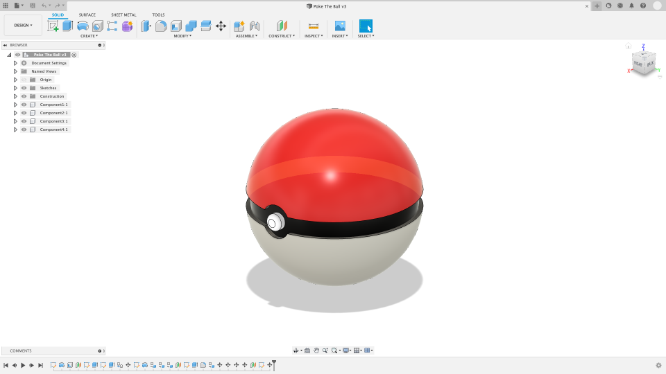
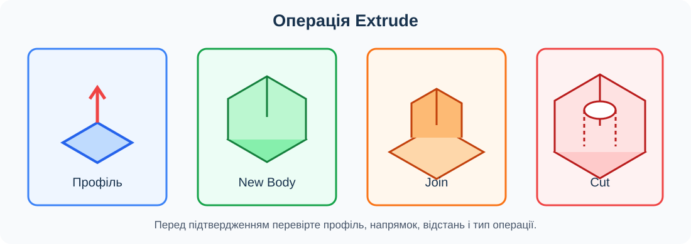
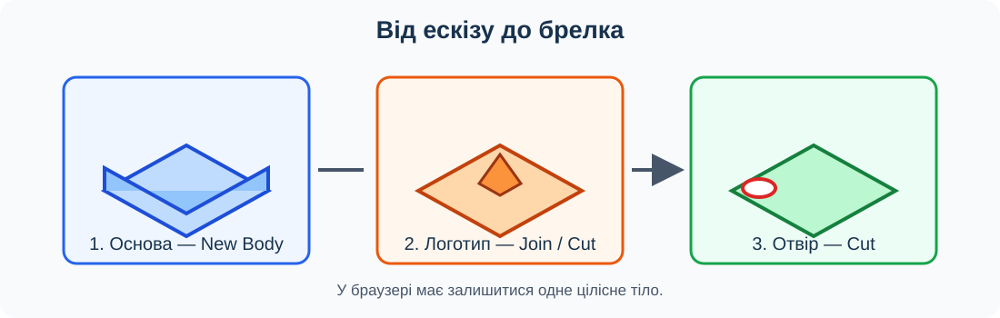

# Урок 7. Витягування (Extrude). Від ескізу до тіла

## Мета та результат

Навчитися перетворювати замкнуті профілі на об’єм, створювати ескіз на плоскій грані та керувати операціями New Body, Join і Cut. На цьому уроці учень або учениця завершує брелок із власним логотипом та один звіт [практичної роботи 1](../../Практичні/pract-01/README.md), розпочатої на уроці 6.

## Інтерфейс Fusion

*Рисунок 1. Приклад робочої області Fusion. Склад панелей може відрізнятися залежно від версії та активного середовища.*

Команда Extrude розташована в **Design → Solid → Create**. У браузері зліва показано ескізи й тіла, а внизу — шкалу історії. Після витягування на ній з’являється окрема операція; подвійне клацання дає змогу змінити її параметри.

Скріншот створила Aylah-a63; джерело — [Wikimedia Commons](https://commons.wikimedia.org/wiki/File:Fusion_360_Screenshot.png), ліцензія [CC BY-SA 4.0](https://creativecommons.org/licenses/by-sa/4.0/). Зображення не змінено.

## Як працює Extrude

**Профіль** — замкнута область ескізу, яку можна вибрати для побудови. **Тіло** — суцільний об’ємний об’єкт, **грань** — частина його поверхні, а **ребро** — межа між двома гранями. Extrude додає профілю глибину та створює або змінює об’єм.

*Рисунок 2. Один замкнутий профіль може створити нове тіло, приєднати матеріал або вирізати його залежно від вибраної операції.*

| Параметр | Призначення |
| --- | --- |
| Profile | Вибрана замкнута область ескізу або плоска грань |
| Direction | One Side, Two Sides або Symmetric |
| Distance | Числова відстань витягування |
| Extent Type | Відстань, до об’єкта або крізь усі видимі тіла |
| New Body | Створює окреме тіло в активному компоненті |
| Join | Приєднує новий об’єм до наявного тіла |
| Cut | Видаляє об’єм із тіла |

Офіційна довідка Autodesk також описує Intersect і New Component, але вони не потрібні для обов’язкового результату цього уроку. Перед підтвердженням перевіряйте профіль, напрямок, відстань і тип операції у попередньому перегляді.

## Ескіз на плоскій грані

Після створення основи виберіть її верхню плоску грань і запустіть Create Sketch. Новий ескіз належатиме цій поверхні: так логотип або коло отвору опиняться безпосередньо на деталі. Для виступу напрямок Extrude спрямований назовні, для заглиблення — всередину основи.

Логотип із кількох замкнутих областей може потребувати одночасного вибору кількох профілів. Перегляньте всю форму перед підтвердженням: пропущена область змінить знак, а випадково вибраний фон може змінити значну частину основи.

Наскрізний отвір зручно створювати Cut з Extent Type **All**, якщо напрямок проходить крізь потрібне тіло. Для неглибокого рельєфу використовуйте точну відстань. Заглиблення 1 мм в основі 3 мм має залишити дно 2 мм.

## Послідовність моделювання брелка

*Рисунок 3. Послідовність операцій: основа як New Body, логотип як Join або неглибокий Cut, отвір як наскрізний Cut.*

## Хід уроку

### 1. Перевірка матеріалів уроку 6

Відкрийте документ «Брелок — логотип». Покажіть пробний ескіз і назвіть замкнуті області знака. Звірте вимоги практичної роботи: основа 40 × 30 × 3 мм, поле логотипу 20 × 20 мм, отвір ⌀4 мм і перемичка до краю не менше 3 мм.

Якщо SVG не утворює потрібних профілів, використайте виправлений файл або навчальний зразок учителя та зазначте це у звіті. Не витрачайте час на повторне створення складного знака під час уроку 7.

### 2. Основа як New Body

Створіть ескіз «Основа» на площині XY. Побудуйте прямокутник 40 × 30 мм із нижньою лівою вершиною в початку координат, задайте розміри й перевірте визначеність. Завершіть ескіз та виконайте Extrude на 3 мм з операцією **New Body**.

У браузері назвіть тіло «Брелок». Поверніть модель і покажіть верхню та нижню грані. На шкалі історії мають бути ескіз і перша операція Extrude.

### 3. Логотип на верхній грані

На верхній грані створіть ескіз «Логотип» і вставте перевірений SVG. Розмістіть його в полі X від 15 до 35 мм, Y від 5 до 25 мм. Перевірте кінцеві габарити та відсутність перетину з майбутнім отвором.

Для виступу виберіть потрібні профілі й виконайте Extrude 1 мм назовні з **Join**. Для заглиблення задайте 1 мм усередину з **Cut**. Оберіть один варіант. Якщо виступ став окремим тілом, відредагуйте операцію на Join; якщо заглиблення пройшло наскрізь, зменште глибину й перевірте напрямок.

### 4. Наскрізний отвір

На верхній грані створіть ескіз «Кріплення». Побудуйте коло ⌀4 мм із центром за 6 мм від лівого та 15 мм від нижнього краю. Задавайте розміри до центра кола, а не до його краю.

Виконайте Extrude з **Cut** крізь усе тіло. Огляньте нижню грань: отвір повинен бути відкритим. Перемичка від лівого краю до краю отвору дорівнює 6 − 2 = 4 мм, тому перевищує мінімальні 3 мм.

### 5. Перевірка тіла й історії

У браузері має залишитися одне тіло. Тимчасово вимкніть його видимість і знову ввімкніть, щоб переконатися, що знак не існує як окремий об’єкт. Послідовно виділіть операції на шкалі історії та покажіть, яка створила основу, рельєф і отвір.

Тимчасово змініть товщину основи на 4 мм і перевірте перебудову наступних операцій; поверніть 3 мм. Змініть рельєф на 1,5 мм, перевірте результат і поверніть 1 мм. Редагуйте наявні операції, а не створюйте дублікати.

### 6. Завершення практичної роботи

Перевірте габарити, цілісність, рельєф, діаметр отвору та перемичку. Скруглення й фаски ще не додавайте: вони є темою уроку 8 і не входять до обов’язкових вимог цієї роботи.

Завершіть єдиний звіт за уроки 6–7. Додайте підписані скріншоти ескізу основи, параметрів Extrude, рельєфу й отвору. Останній скріншот має показувати весь брелок під кутом, щоб одночасно було видно знак і отвір.

## Завдання

Виконайте розділ **«Урок 7. Об’ємна модель брелка»** у [практичній роботі 1](../../Практичні/pract-01/README.md). Результат — одне тіло брелка з основою 40 × 30 × 3 мм, власним логотипом у вигляді виступу або заглиблення та наскрізним отвором ⌀4 мм.

## Типові помилки

- Вибрано зовнішній фон ескізу замість потрібних профілів знака.
- Логотип створено як New Body, хоча він має бути частиною брелка.
- Напрямок Cut спрямований від основи й не видаляє матеріал.
- Заглиблення проходить наскрізь і не залишає дна.
- Отвір має правильний діаметр, але не проходить крізь нижню грань.
- Після виправлення створено дублікати ескізів або операцій.

## Перевірка результату

- Основа має розміри 40 × 30 × 3 мм.
- Логотип міститься в заданому полі й не перетинає отвір.
- Рельєф має глибину або висоту 1 мм і належить основному тілу.
- Отвір ⌀4 мм наскрізний, а перемичка до лівого краю становить 4 мм.
- У браузері є одне тіло, а історія має зрозумілу послідовність операцій.
- Учень або учениця пояснює різницю між New Body, Join і Cut.
- Звіт практичної роботи містить послідовні докази уроків 6–7.

## Довідка

- [Витягування твердого тіла — офіційна довідка Autodesk](https://help.autodesk.com/view/fusion360/ENU/?guid=SLD-EXTRUDE-SOLID).
- [Створення тіл з ескізів — Autodesk](https://help.autodesk.com/cloudhelp/ENU/Fusion-Model/files/SLD-CREATE-SOLID-FROM-SKETCH.htm).
- [Вставлення SVG — Autodesk](https://help.autodesk.com/cloudhelp/ENU/Fusion-Model/files/SLD-INS-SVG.htm).

[До тематичного плану](../../README.md) · [Попередній урок](../less-06/README.md) · [Наступний урок](../less-08/README.md)
