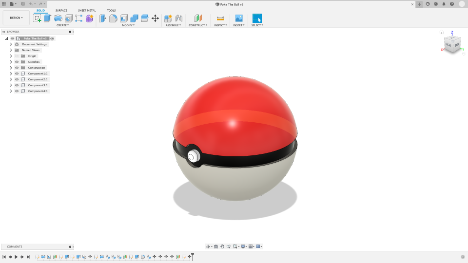
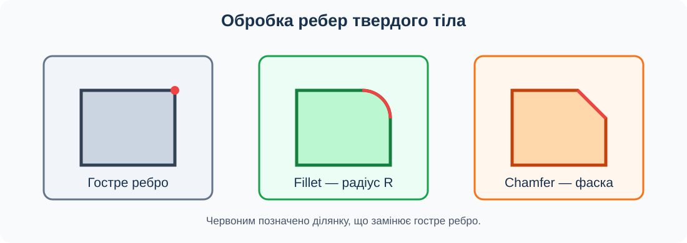
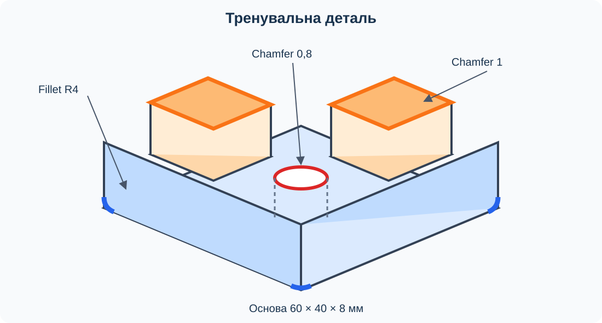

# Урок 8. Скруглення та фаски

## Мета та результат

Навчитися обробляти ребра твердого тіла командами Fillet і Chamfer, добирати допустимі значення параметрів та виправляти невдалий результат через редагування операції. Наприкінці уроку учень або учениця має створити просту тренувальну деталь, застосувати скруглення й фаски до різних груп ребер та пояснити відмінність отриманих форм.

## Інтерфейс Fusion

*Рисунок 1. Приклад робочої області Fusion. Склад і розташування панелей можуть дещо відрізнятися залежно від версії програми.*

Команди уроку розміщені в **Design → Solid → Modify**. Після застосування Fillet або Chamfer операцію можна відкрити на шкалі історії та змінити її параметри.

Скріншот створила Aylah-a63; джерело — [Wikimedia Commons](https://commons.wikimedia.org/wiki/File:Fusion_360_Screenshot.png), ліцензія [CC BY-SA 4.0](https://creativecommons.org/licenses/by-sa/4.0/). Зображення не змінено.

## Скруглення та фаска

**Ребро** — лінія, уздовж якої зустрічаються дві грані твердого тіла. Гостре ребро можна замінити криволінійною або плоскою перехідною гранню.

- **Fillet** створює скруглення. Для простого скруглення задають постійний радіус, наприклад R3 мм.
- **Chamfer** створює фаску — плоский скіс уздовж ребра. У простому варіанті Equal Distance задають однакову відстань на двох суміжних гранях.
- **Попередній перегляд** дає змогу перевірити вибрані ребра й форму результату до підтвердження операції.
- **Набір вибору** об’єднує ребра, які обробляються однаковим параметром у межах однієї операції.

*Рисунок 2. Fillet замінює гостре ребро дугою заданого радіуса, а Chamfer — похилою плоскою гранню.*

| Ознака | Fillet | Chamfer |
| --- | --- | --- |
| Форма нової грані | Криволінійна | Плоска похила |
| Основний параметр | Радіус | Відстань або відстань і кут |
| Навчальний приклад | Пом’якшення зовнішніх кутів деталі | Скіс на вході кріпильного отвору |
| Позначення в завданні | R2, R4 | 1 мм або 1 × 45° |

Розмір операції обмежує навколишня геометрія. Якщо радіус завеликий, скруглення може зіткнутися із сусіднім ребром або повністю поглинути вузьку грань. Fusion тоді не створює коректний попередній перегляд або повідомляє про помилку. Потрібно перевірити вибір ребер і зменшити значення, а не повторювати ту саму операцію поверх невдалої.

## Завдання та вихідні дані

Створіть тренувальну деталь за рисунком 3. Усі розміри наведено в міліметрах.

*Рисунок 3. Основа 60 × 40 × 8 мм із двома верхніми виступами й наскрізним отвором; кольорові позначення показують групи ребер для обробки.*

| Елемент | Розмір або операція |
| --- | --- |
| Основа | Прямокутник 60 × 40; Extrude 8; New Body |
| Лівий виступ | Прямокутник 18 × 16 на верхній грані; Extrude 8; Join |
| Правий виступ | Прямокутник 18 × 16 на верхній грані; Extrude 8; Join |
| Отвір | Коло ⌀10 між виступами; Extrude крізь усе тіло; Cut |
| Скруглення | Чотири вертикальні кутові ребра основи; Fillet R4 |
| Фаски виступів | Верхні периметри двох виступів; Chamfer 1 |
| Фаска отвору | Верхнє кругове ребро; Chamfer 0,8 |

Виступи розташуйте симетрично. Їхнє положення визначте розмірами так, щоб вони не виходили за межі основи й не перетинали отвір.

## Хід уроку

### 1. Повторення Extrude та підготовка

Створіть новий документ «Тренування ребер». На площині XY побудуйте центральний прямокутник 60 × 40 мм і витягніть його на 8 мм як New Body. На верхній грані створіть ескіз двох прямокутників 18 × 16 мм, розташуйте їх симетрично та витягніть на 8 мм з операцією Join.

Між виступами створіть коло ⌀10 мм і виконайте Cut крізь усе тіло. Огляньте модель знизу, щоб підтвердити наскрізність. Перед обробкою ребер збережіть документ: так можна повернутися до правильної вихідної форми.

### 2. Вибір ребер і Fillet

Поверніть модель та знайдіть чотири вертикальні ребра зовнішніх кутів основи. Відкрийте **Solid → Modify → Fillet**, виберіть усі чотири ребра й задайте постійний радіус 4 мм. Перевірте попередній перегляд з кількох напрямків і підтвердьте операцію.

Знайдіть Fillet на шкалі історії та тимчасово змініть радіус на 6 мм. Якщо Fusion не будує результат або скруглення займає неприйнятно велику частину грані, поясніть причину й поверніть R4. Дослід показує геометричне обмеження операції, але збережений результат має відповідати таблиці.

### 3. Фаски на виступах

Відкрийте **Solid → Modify → Chamfer**. Виберіть верхні зовнішні периметри обох виступів. Переконайтеся, що не вибрано їхні нижні ребра на стику з основою. Встановіть тип **Equal Distance** і значення 1 мм.

Якщо команда автоматично захоплює дотично пов’язані ребра, перевірте Tangent Chain та склад набору вибору. У попередньому перегляді обидва виступи мають отримати однаковий вузький скіс, а їхня основна висота й положення не повинні змінитися.

### 4. Фаска на отворі

Створіть окрему операцію Chamfer для верхнього кругового ребра отвору. Задайте Equal Distance 0,8 мм. Огляньте отвір зверху й збоку: біля входу має з’явитися похила кільцева грань, а отвір повинен залишитися наскрізним.

Порівняйте фаску зі зміною діаметра кола в початковому ескізі. Збільшення діаметра перебудувало б увесь циліндричний отвір, а фаска змінює лише його край.

### 5. Редагування та пошук помилок

Послідовно виділіть операції Fillet і Chamfer на шкалі історії. За підсвічуванням перевірте, які грані вони створили. Відредагуйте фаску виступів до 2 мм, оцініть результат і поверніть 1 мм. Відредагуйте фаску отвору до 1,5 мм, перевірте попередній перегляд і поверніть 0,8 мм.

Якщо операція не перебудовується, не видаляйте довільні елементи. Визначте конкретну причину: завелике значення, зайве ребро в наборі, відсутнє ребро після попередньої зміни або неправильний порядок операцій. Поверніть останнє працездатне значення та переконайтеся, що на шкалі історії немає дубльованих невдалих операцій.

### 6. Порівняння результатів

Порівняйте три типи ребер на одній моделі: гостре нижнє ребро, скруглені вертикальні кути та скошені верхні краї. Назвіть форму нової грані в кожному випадку. Поясніть, чому для різних груп ребер використано окремі операції та різні параметри.

Збережіть документ. Під час взаємоперевірки один учень показує операцію на шкалі історії, інший називає вибрані ребра й параметр, який визначає результат.

## Типові помилки

- Вибрано грань, контур ескізу або силует замість ребра твердого тіла.
- До одного набору потрапили ребра, яким потрібні різні параметри.
- Радіус або відстань більші за доступний простір між сусідніми гранями.
- Фаску застосовано до нижнього кругового ребра отвору замість верхнього.
- Tangent Chain додав ребра, яких немає в завданні.
- Після невдалого перегляду створено нову операцію замість редагування наявної.

## Перевірка результату

- Основа має габарити 60 × 40 × 8 мм, а два виступи приєднані до неї.
- Отвір ⌀10 проходить крізь основу й не перетинає виступи.
- Чотири вертикальні кутові ребра основи мають Fillet R4.
- Верхні периметри виступів мають Chamfer 1 мм.
- Верхнє кругове ребро отвору має Chamfer 0,8 мм.
- На шкалі історії є одна операція Fillet і дві окремі операції Chamfer без помилок.
- Учень або учениця пояснює відмінність скруглення від фаски та називає спосіб виправлення завеликого параметра.

## Довідка

- [Створення скруглення — офіційна довідка Autodesk](https://help.autodesk.com/cloudhelp/ENU/Fusion-Model/files/SLD-FILLET-SOLID.htm).
- [Створення фаски — офіційна довідка Autodesk](https://help.autodesk.com/cloudhelp/ENU/Fusion-Model/files/SLD-CHAMFER-SOLID.htm).
- [Інструменти зміни твердих тіл — Autodesk](https://help.autodesk.com/cloudhelp/ENU/Fusion-Model/files/SLD-MODIFY-SOLID-BODY.htm).

## Навігація

[До тематичного плану](../../README.md) · [Попередній урок](../less-07/README.md) · [Наступний урок](../less-09/README.md)
