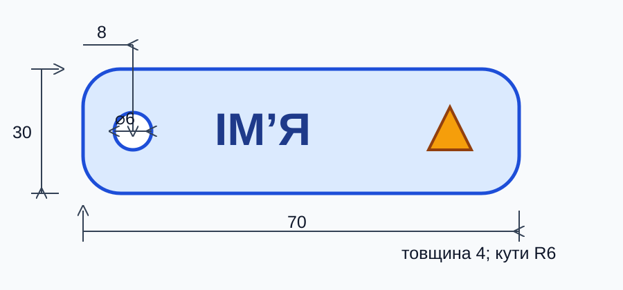
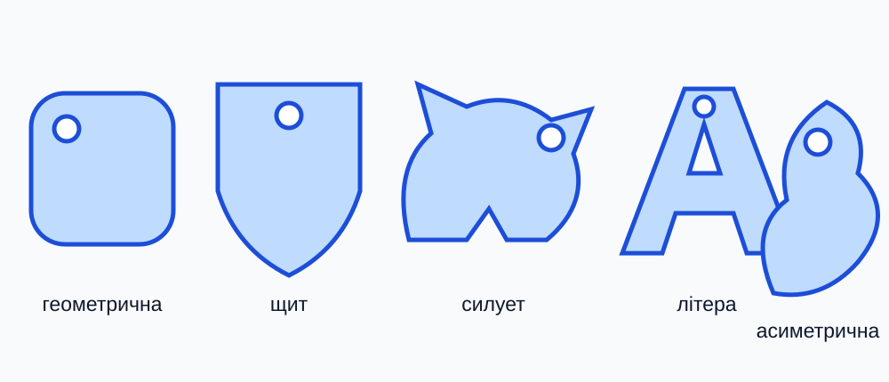
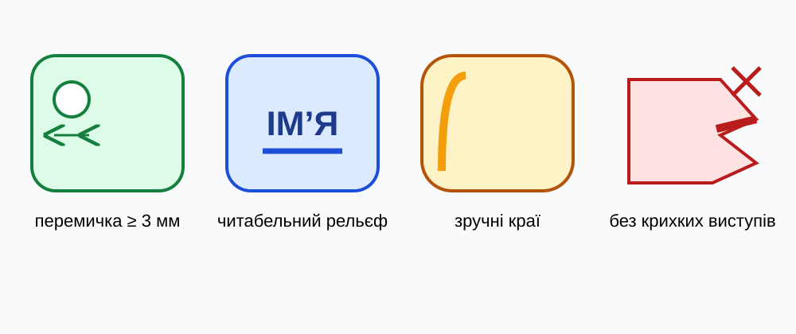

# Урок 9. Іменний брелок: текст, логотип і кріпильний отвір

## Мета та результат

Закріпити послідовне використання ескізу, Extrude, тексту, імпортованого SVG, вирізання, скруглень і фасок. Наприкінці уроку учень або учениця завершує [практичну роботу 3](#практична-робота--3): авторський брелок із перевіреними габаритами, читабельним написом і міцною ділянкою біля отвору.

## Аналіз конструкції

Брелок складається з основи, отвору для кільця, імені та невеликого логотипа. Кожний елемент виконує окрему функцію: основа об’єднує модель, отвір забезпечує кріплення, напис і логотип персоналізують виріб, а оброблені краї роблять форму завершеною.

*Рисунок 1. Навчальна конструкція брелока; розміри наведено в міліметрах.*

| Елемент | Розміри навчального прикладу |
| --- | --- |
| Основа | 70 × 30 × 4 мм; кути R6 |
| Отвір | ⌀6 мм; центр на відстані 8 мм від лівого краю |
| Перемичка | не менше 3 мм від отвору до краю деталі |
| Ім’я | від 3 до 8 літер; висота символів 8–10 мм |
| Рельєф напису | виступ 1 мм або заглиблення 0,8 мм |
| Логотип | замкнений контур із SVG уроку 6; найбільший розмір до 12 мм |
| Обробка | Fillet R2 на вертикальних ребрах; Chamfer 0,5 мм біля отвору |

## Демонстрація напису й логотипа

Для прикладу з рисунка 1 розмістіть рамку Text праворуч від отвору. Виберіть контурний шрифт заввишки 8–10 мм і залиште навколо напису 2 мм. Застосуйте Extrude з Join для виступу 1 мм або Cut для заглиблення 0,8 мм. Explode Text перетворює символи на криві та прибирає можливість редагувати їх як текст.

У новому ескізі використайте Insert SVG і масштабуйте логотип до 12 мм. Перевірте, чи можна вибрати замкнену область. Якщо її межі розірвані або накладаються, виправте джерельний файл в Inkscape. Зберігайте напис і логотип в окремих ескізах, щоб редагувати їх незалежно.

## Практична робота № 3

**Авторський брелок**

### Час і мета

45–60 хвилин у межах уроків 7–9. Почніть основу й отвір на [уроці 7](../less-07/README.md), відпрацюйте обробку ребер на [уроці 8](../less-08/README.md), завершіть персоналізацію на уроці 9. Перевірте цілісність моделі, міцність біля отвору й читабельність напису.

### Завдання

Розробіть брелок довільної форми. Це може бути геометрична фігура, силует предмета, літера, емблема, тварина або власна абстрактна композиція. Брелок повинен мати наскрізний отвір або вушко для кільця, читабельний напис і доречно оброблені краї.

*Рисунок 2. Приклади напрямів пошуку форми: геометрична пластина, щит, силует, літера та асиметрична композиція. Це не готові шаблони для копіювання.*

Форма має бути авторським рішенням учня або учениці. Схеми на рисунку 2 допомагають оцінити пропорції, але не визначають обов’язковий контур.

### Вихідні дані та технічні вимоги

| Елемент | Обов’язкова вимога |
| --- | --- |
| Форма | довільна, але замкнена, цілісна й придатна до виготовлення |
| Габарити | найбільший розмір 45–80 мм; товщина основи 3–5 мм |
| Напис | короткий текст, ініціали або ім’я; читабельний і розміщений у межах основи |
| Рельєф | виступ або заглиблення напису 0,6–1,5 мм |
| Кріплення | наскрізний отвір ⌀4–6 мм або вушко з таким отвором |
| Перемичка | не менше 3 мм матеріалу від краю отвору до зовнішнього краю |
| Обробка | щонайменше одне доречне скруглення та одна фаска |
| Результат | одне цілісне тіло без відокремлених літер і декоративних фрагментів |

Для створення форми й оздоблення дозволено використовувати **Extrude**, **Join**, **Cut**, отвори, **Fillet**, **Chamfer**, текстові ескізи та **Insert SVG**. Готовий SVG дозволено використати як декоративний елемент, але потрібно вказати його джерело й умови використання. Імпортований знак не повинен замінювати самостійне моделювання основи.

### Технологічність брелока

Оцінюється не лише зовнішній вигляд, а й потенційна придатність виробу до щоденного використання.

*Рисунок 3. Перевірка технологічності: достатня перемичка біля отвору, читабельний рельєф, зручні краї та відсутність крихких виступів.*

Брелок має бути зручним у руці, не мати невиправдано гострих кутів і дуже тонких виступів. Отвір не можна розміщувати в слабкій вузькій ділянці. Напис і логотип не повинні створювати окремих елементів, які легко відламаються. Надмірно глибоке вирізання послаблює основу, а занадто дрібний рельєф може бути нерозбірливим після виготовлення.

### Послідовність виконання

1. Побудуйте замкнений авторський контур і витягніть основу. Виріжте наскрізний отвір та виміряйте перемичку до найближчого краю.
2. Зробіть напис рельєфним. Якщо додаєте SVG, імпортуйте його в окремий ескіз і перевірте профілі.
3. Додайте фаску та скруглення. Огляньте модель зверху й у перспективі. Виміряйте фактичні габарити, перевірте цілісність тіла та історію операцій.

### Що подати на перевірку

Один звіт Markdown або PDF із коротким задумом, фактичними розмірами й висновком про технологічність брелока.

### Вимоги до звіту

Пронумеруйте скріншоти ескізу, основи, отвору, рельєфу, країв і готового брелока. Під кожним поясніть дію, видимі параметри й результат. Важливі розміри мають читатися, останній скріншот показує повну модель. Для запозиченого SVG укажіть джерело, автора та ліцензію.

Для 12-го бала окремо назвіть новий прийом, поясніть, чому його не розглядали на уроках 7–9 і як він покращив виконання, та вкажіть номер скріншота. Без обґрунтування творчий бал не нараховується.

### Критерії оцінювання

| Критерій | Максимум балів |
| --- | ---: |
| Авторська форма, правильні габарити та цілісне тіло | 2 |
| Наскрізний отвір і перемичка не менше 3 мм | 2 |
| Читабельний напис із коректним рельєфом | 2 |
| Доречні фаски, скруглення та інші операції | 1 |
| Технологічність: зручність, міцність і довговічність | 2 |
| Послідовний звіт Markdown/PDF зі скріншотами та змістовними підписами | 2 |
| **Разом за обов’язкові вимоги** | **11** |
| Доречний творчий прийом Fusion поза матеріалами відповідних уроків, обґрунтований у звіті | 1 |
| **Разом** | **12** |

Творчий бал не залежить від наявності логотипа: його розроблення вже оцінено в практичній роботі 2. Формальне застосування додаткової команди без впливу на спосіб або якість результату не зараховується.

### Правила самостійного виконання та дозволені джерела

Модель виконуйте самостійно. Дозволено користуватися матеріалами уроків, офіційною довідкою Fusion, власним SVG із практичної роботи 2 або SVG із відкритою ліцензією. Не видавайте чужий знак або готову модель за власну роботу.

## Довідка

- [Створення тексту в ескізі — Autodesk](https://help.autodesk.com/cloudhelp/ENU/Fusion-Sketch/files/SKT-CREATE-TEXT.htm).
- [Вставлення SVG — Autodesk](https://help.autodesk.com/cloudhelp/ENU/Fusion-Sketch/files/SKT-INSERT-SVG.htm).
- [Витягування твердого тіла — Autodesk](https://help.autodesk.com/cloudhelp/ENU/Fusion-Model/files/SLD-EXTRUDE-SOLID-BODY.htm).

## Навігація

[До тематичного плану](../../README.md) · [Попередній урок](../less-08/README.md) · [Наступний урок](../less-10/README.md)
