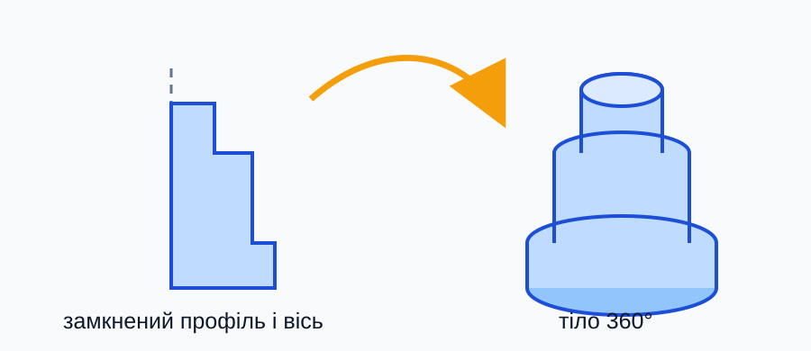
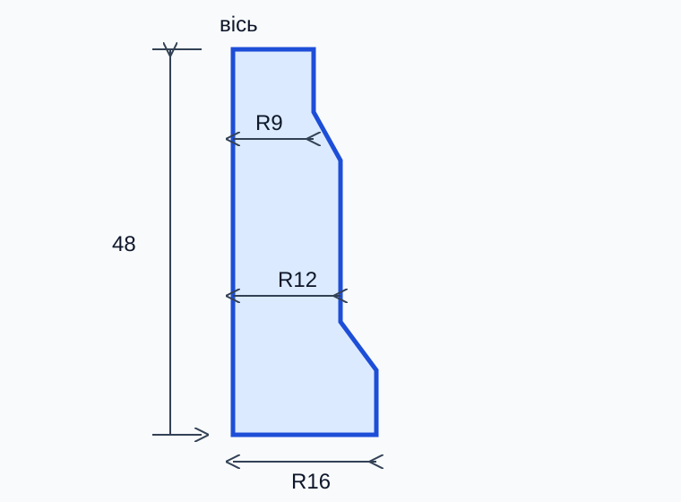

# Урок 10. Обертання (Revolve)

## Мета та результат

Навчитися створювати тіло обертання за плоским профілем і віссю, керувати кутом та напрямком операції Revolve, а також прогнозувати вплив розмірів ескізу на готову форму. Результат уроку — параметрична ступінчаста ручка, побудована одним обертанням.

## Як утворюється тіло обертання

Під час Revolve замкнений профіль рухається навколо прямої. Кожна точка профілю описує коло, тому результат має обертальну симетрію. Вісь може бути лінією ескізу, допоміжною віссю або прямолінійним ребром моделі. Вісь не повинна довільно перетинати замкнену область профілю: таке розташування часто створює самоперетин.

*Рисунок 1. Замкнений профіль праворуч від допоміжної осі перетворюється на ступінчасте тіло після обертання на 360°.*

| Параметр | Призначення |
| --- | --- |
| Profile | замкнена область ескізу, що обертається |
| Axis | пряма, навколо якої рухається профіль |
| Extent | спосіб задання протяжності: кут або повне обертання |
| Angle | кут обертання; 360° створює повне тіло |
| Direction | один бік, два боки або симетричний напрямок |
| Operation | New Body, Join, Cut або Intersect |

На відміну від Extrude, команда Revolve не переносить однаковий профіль уздовж прямої. Вона змінює його орієнтацію під час руху. Тому для кулі, вала, ручки чи шахової фігури достатньо побудувати половину поздовжнього перерізу.

## Вихідні дані

Створіть ступінчасту ручку за профілем на рисунку 2. Усі горизонтальні розміри відкладаються від осі й визначають радіуси, а вертикальні — висоти ділянок.

*Рисунок 2. Навчальний профіль: загальна висота 48 мм, основа радіусом 16 мм і верхня частина радіусом 9 мм.*

| Ділянка | Розмір |
| --- | --- |
| Основа | радіус 16 мм; висота 8 мм |
| Перехід | від R16 до R12; висота 6 мм |
| Середня частина | радіус 12 мм; висота 20 мм |
| Верхній перехід | від R12 до R9; висота 6 мм |
| Верхня частина | радіус 9 мм; висота 8 мм |
| Загальна висота | 48 мм |

## Хід уроку

### 1. Підготовка ескізу

Створіть новий документ і компонент «Ступінчаста ручка». Відкрийте ескіз на площині XZ. Проведіть вертикальну лінію через початок координат, змініть її тип на **Construction** і назвіть її віссю профілю. Допоміжна лінія бере участь в обмеженнях, але не створює межу профілю.

Почніть контур у нижній точці осі. Побудуйте його лише праворуч від осі: нижня горизонталь, зовнішні вертикальні й похилі ділянки, верхня горизонталь і завершальна лінія назад уздовж осі. Отримана область має бути замкненою та зафарбованою.

### 2. Задання розмірів

Закріпіть нижню точку профілю в початку координат. Задайте горизонтальним відрізкам радіуси 16, 12 і 9 мм. Вертикальними розмірами визначте послідовні висоти 8, 6, 20, 6 і 8 мм. Не задавайте окремо загальну висоту 48 мм як керувальний розмір, якщо вона вже є сумою ділянок: це створить надлишкове обмеження.

Перевірте колір геометрії та спробуйте перетягнути характерні точки. Визначений ескіз не повинен довільно змінювати форму. Вісь має залишатися допоміжною, а контур — замкненим.

### 3. Створення Revolve

Завершіть ескіз і відкрийте **Solid → Create → Revolve**. Як Profile виберіть зафарбовану область, як Axis — вертикальну допоміжну лінію. Установіть повне обертання 360° та операцію **New Body**. Огляньте попередній результат і підтвердьте команду.

Поверніть модель. Круглі ребра всіх ступенів мають бути концентричними. Якщо утворилася тонка поверхня замість твердого тіла, профіль був відкритим або вибрано не всю потрібну область.

### 4. Дослідження кута

Відредагуйте Revolve та змініть кут з 360° на 180°. На моделі з’являться дві плоскі радіальні грані, які показують початкове й кінцеве положення профілю. Змініть кут на 90° і спрогнозуйте результат до підтвердження. Після досліду поверніть 360°.

Порівняйте **One Side** і **Symmetric** для неповного кута. За симетричного режиму половина заданого кута відкладається в кожний бік від площини ескізу. Для готової ручки залиште повне обертання.

### 5. Параметричне редагування

Відкрийте початковий ескіз і змініть радіус середньої частини з 12 на 10 мм. Завершіть ескіз: Revolve має перебудуватися автоматично, а загальна висота не зміниться. Потім змініть висоту середньої ділянки з 20 на 24 мм і визначте нову загальну висоту — 52 мм.

Поверніть початкові значення R12 і 20 мм. Поясніть, чому редагування профілю змінює ціле тіло та чому для осесиметричної деталі цей спосіб коротший за побудову багатьох циліндрів.

### 6. Перевірка

Скористайтеся **Inspect → Measure**. Перевірте загальну висоту 48 мм і діаметри 32, 24 та 18 мм. Радіус профілю після повного обертання перетворюється на половину діаметра тіла, тому R16 відповідає ⌀32.

Назвіть ескіз «Профіль ручки», а операцію — «Повне обертання». Збережіть документ. На шкалі історії має бути один ескіз і одна операція Revolve без попереджень.

## Типові помилки

- використано звичайну лінію осі, яка ділить профіль на зайві області;
- контур не замкнений або містить накладені відрізки;
- вибрано зовнішнє ребро замість допоміжної осі;
- профіль перетинає вісь і після обертання створює самоперетин;
- радіус помилково введено як діаметр;
- у готовій моделі залишено дослідний кут 90° або 180°;
- додано надлишковий розмір загальної висоти.

## Перевірка результату

- профіль повністю визначений і розміщений з одного боку осі;
- вісь має тип Construction;
- Revolve виконано на 360° як New Body;
- тіло має висоту 48 мм і контрольні діаметри ⌀32, ⌀24 та ⌀18;
- зміна одного розміру профілю прогнозовано перебудовує тіло;
- учень або учениця пояснює різницю між Extrude та Revolve.

## Довідка

- [Створення твердого тіла командою Revolve — Autodesk](https://help.autodesk.com/cloudhelp/ENU/Fusion-Model/files/SLD-REVOLVE-SOLID.htm).
- [Допоміжна геометрія ескізу — Autodesk](https://help.autodesk.com/cloudhelp/ENU/Fusion-Sketch/files/SKT-CONSTRUCTION-GEOMETRY.htm).

## Навігація

[До тематичного плану](../../README.md) · [Попередній урок](../less-09/README.md) · [Наступний урок](../less-11/README.md)
