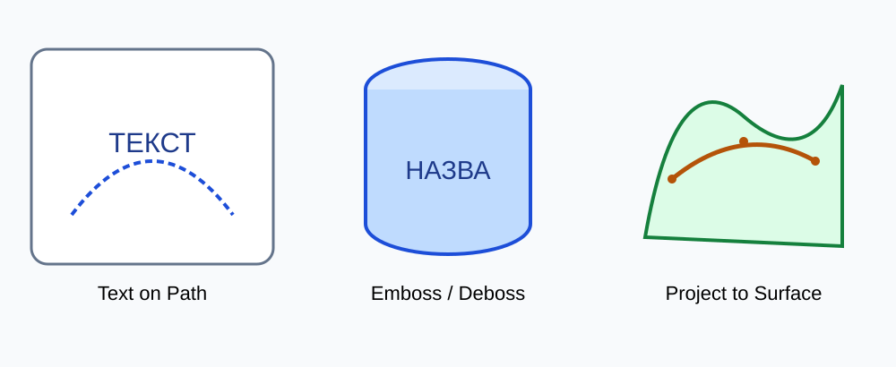

# Урок 11. Тіла обертання: форма, кріплення та текст

## Мета та результат

Поєднати Revolve з кріпленням і нанесенням напису. Результат — брелок за умовами [практичної роботи 4](#практична-робота--4).

## Що таке тіло обертання

Тіло обертання утворюється поворотом замкненого профілю навколо осі на 360°. Відстань від осі до точки профілю стає радіусом: 12 мм від осі утворює діаметр 24 мм.

Профіль будують з одного боку допоміжної осі Construction, замикають відрізком уздовж неї та перевіряють відсутність самоперетинів.

*Рисунок 1. П’ять можливих основ: пішак, пляшечка, дзвіночок, капсула та башта. Вушко й отвір додаються після Revolve.*

## П’ять варіантів основи

| Варіант | Характер профілю | Орієнтовні габарити | Місце кріплення |
| --- | --- | --- | --- |
| 1. Пішак або навершник | уступи, шийка, округлена голівка | 45–60 мм; ⌀24–30 мм | біля шийки |
| 2. Пляшечка або ваза | широка основа, звуження, горлечко | 45–65 мм; ⌀22–30 мм | на горлечку |
| 3. Дзвіночок | вузька верхівка, розширення донизу | 35–50 мм; ⌀24–32 мм | угорі або збоку |
| 4. Капсула або намистина | дуги й циліндрична середина | 35–55 мм; ⌀18–26 мм | на кінці |
| 5. Башта або маяк | уступи й конічний верх | 50–70 мм; ⌀22–30 мм | під уступом |

## Три способи розміщення напису

*Рисунок 2. Text on Path керує напрямком тексту в плоскому ескізі, Emboss/Deboss створює рельєф на грані, а Project to Surface переносить криві на складну поверхню.*

- **Text on Path.** У плоскому ескізі побудуйте дугу, коло або сплайн, виберіть його в полі Path і задайте висоту та положення напису. На плоскій грані використайте Join або Cut на 0,5–1 мм.
- **Emboss/Deboss.** Створіть напис контурним шрифтом на площині перед гладкою ділянкою. Виберіть профілі літер і потрібну грань, задайте 0,5–0,8 мм, налаштуйте положення й перевірте попередній вигляд.
- **Project to Surface.** У копії ескізу перетворіть текст на криві через Explode Text. У новому ескізі виберіть грань і криві, перевірте напрямок проєкції. Команда розміщує криві на поверхні. Для рельєфу, який не вдається побудувати на цій ділянці, виберіть простішу грань.

## Тест перед практичною роботою № 4

Після пояснення способів розміщення напису пройдіть тест у Moodle. Файл для імпорту запитань — [Тест за матеріалами уроків 10–11](../../Тести/test-less-10-11.gift).

## Практична робота № 4

**Авторський брелок на основі тіла обертання**

### Час і мета

45–60 хвилин. Створіть визначений половинний профіль, обертальну основу, вушко й читабельну персоналізацію. Перевірте габарити та цілісність виробу.

### Завдання

Побудуйте основу брелока повним обертанням. Оберіть силует із таблиці вище або запропонуйте власний.

Змініть щонайменше три пропорції або характерні ділянки обраного профілю.

### Технічні вимоги

| Елемент | Обов’язкова вимога |
| --- | --- |
| Основна форма | Revolve 360° із замкненого визначеного профілю |
| Габарити | висота 35–70 мм; найбільший діаметр 18–32 мм |
| Опорна або кінцева грань | без небезпечного вістря; плоска, якщо виріб має стояти |
| Вушко | приєднане операцією Join; перекриття з основою не менше 3 мм |
| Отвір | наскрізний ⌀4–6 мм; перемичка до краю не менше 3 мм |
| Обробка | щонайменше одне доречне скруглення та одна фаска |
| Персоналізація | короткий напис, готовий SVG або власний логотип із практичної роботи 2 |
| Текст | на плоскій грані, уздовж кривої або через Emboss/Deboss на придатній криволінійній поверхні |
| Результат | одне цілісне тіло без різьби й відокремлених деталей |

*Рисунок 3. Загальний робочий процес: профіль, Revolve, приєднане вушко з отвором і персоналізація.*

### Навчальний приклад: брелок-дзвін

У зображенні дзвона виділяємо широку нижню крайку, плавне звуження, кільцеві уступи та верхню шийку. Корону, язик і дрібний декор не моделюємо.

*Рисунок 4. Приклад спрощення дзвона до половинного профілю Revolve; усі розміри наведено в міліметрах.*

| Параметр дзвона | Значення |
| --- | ---: |
| Загальна висота тіла | 48 мм |
| Найбільший діаметр нижньої крайки | 30 мм |
| Діаметр середньої частини | 22 мм |
| Діаметр верхньої шийки | 12 мм |
| Висота нижньої крайки | 6 мм |
| Вушко | 16 × 12 × 6 мм |
| Отвір | ⌀5 мм |

Побудуйте контур із крайкою R15, корпусом до R11 і шийкою R6. Замкніть його на осі й виконайте Revolve 360°. Вушко витягніть симетрично з Join і виріжте отвір Through All. Для прикладу використайте фаску 0,5 мм, Fillet R1–R2 і короткий напис на плавному поясі або плоскій грані.

[Скрипт демонстраційного дзвона з написом](fusion/README.md).

### Послідовність власного варіанта

1. Оберіть образ, габарити, місце вушка та спосіб персоналізації.
2. Створіть визначений половинний профіль з одного боку осі, використовуючи відрізки, дотичні дуги або сплайн. Не додавайте різьбу.
3. Виконайте Revolve 360° як New Body та перевірте висоту й діаметр через Measure.
4. Побудуйте вушко з перекриттям не менше 3 мм, витягніть його з Join і виріжте отвір ⌀4–6 мм Through All.
5. Перевірте перемичку 3 мм, додайте доречні Chamfer і Fillet та переконайтеся, що в браузері залишилося одне тіло.

#### Персоналізація

Виберіть один спосіб персоналізації з таблиці й застосуйте прийом із розділу «Три способи розміщення напису».

### Приклад оздоблення

*Рисунок 5. Геометричний пояс Emboss і напис Deboss на дзвоні.*

Для демонстрації застосуйте до елемента пояса Emboss 0,4–0,7 мм або до напису Deboss 0,4–0,6 мм. Переконайтеся, що рельєф не перетинає уступи. Для остаточної перевірки змініть один розмір профілю, перевірте перебудову та поверніть значення.

### Що подати на перевірку

Звіт Markdown або PDF із пронумерованими скріншотами профілю, Revolve, вушка, отвору, обробки країв, персоналізації та повної моделі.

### Вимоги до звіту

Під кожним скріншотом назвіть дію, важливі параметри й отриманий результат. Останній скріншот має показувати весь брелок у перспективі. Для тексту на криволінійній поверхні додайте окремий близький вигляд.

### Критерії оцінювання

| Критерій | Максимум балів |
| --- | ---: |
| Авторський визначений профіль і правильна вісь | 2 |
| Коректне Revolve 360° та дотримання габаритів | 2 |
| Надійне вушко, наскрізний отвір і перемичка | 2 |
| Доречні фаска, скруглення та цілісність тіла | 2 |
| Читабельний напис або SVG, правильно нанесений на обрану поверхню | 1 |
| Послідовний звіт зі скріншотами й підписами | 2 |
| **Разом за обов’язкові вимоги** | **11** |
| Доречний творчий прийом поза матеріалами уроків із обґрунтуванням і скріншотом | 1 |
| **Разом** | **12** |

Для 12-го бала окремо назвіть прийом, поясніть, чому він виходить за межі уроків 10–11 і як покращує спосіб або якість роботи, та вкажіть номер скріншота. Без текстового обґрунтування творчий бал не нараховується.

### Правила самостійного виконання та дозволені джерела

Виконуйте профіль і модель самостійно. Дозволено користуватися уроками 10–11, офіційною довідкою Autodesk, власним SVG із практичної роботи 2 або SVG із відкритою ліцензією. Не копіюйте готову модель і не використовуйте різьбу.

## Довідка

- [Revolve для твердого тіла — Autodesk](https://help.autodesk.com/cloudhelp/ENU/Fusion-Model/files/SLD-REVOLVE-SOLID.htm).
- [Параметри Text і Text on Path — Autodesk](https://help.autodesk.com/cloudhelp/ENU/Fusion-Sketch/files/SKT-REF-TEXT-DIALOG.htm).
- [Emboss і Deboss на твердому тілі — Autodesk](https://help.autodesk.com/view/fusion360/ENU/?contextId=SLD-EMBOSS).
- [Проєкція ескізу або тексту на криву поверхню — Autodesk](https://help.autodesk.com/view/fusion360/ENU/?caas=caas/sfdcarticles/sfdcarticles/Projecting-a-sketch-to-a-curved-cylinder-in-Fusion-360.html).

## Навігація

[До тематичного плану](../../README.md) · [Попередній урок](../less-10/README.md) · [Наступний урок](../less-12/README.md)
