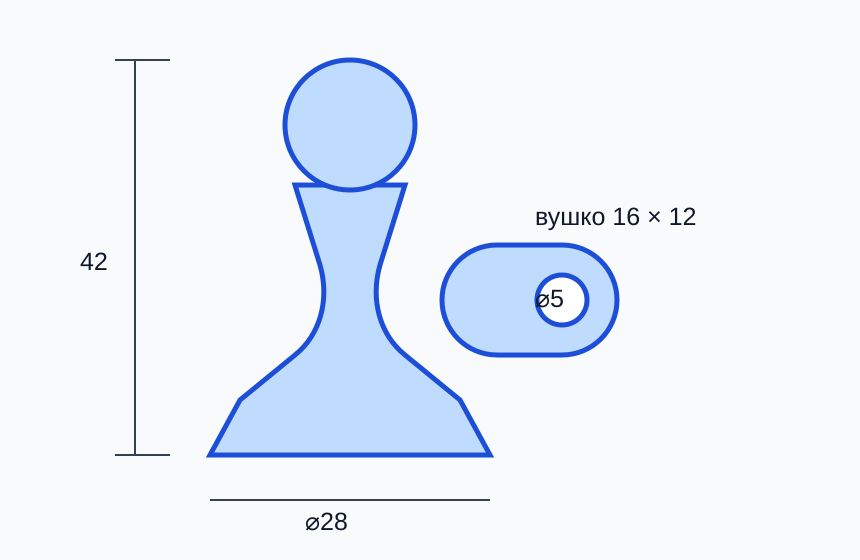

# Урок 11. Брелок у вигляді шахової фігури

## Тема, час і мета

**Орієнтовний час:** 45 хвилин.

Практична робота № 3 закріплює створення тіла обертання та поєднання його з витягуванням і вирізанням. Потрібно змоделювати спрощений шаховий пішак, додати вушко з наскрізним отвором, логотип і безпечну обробку країв.

Після виконання роботи учень або учениця вміє читати профіль осесиметричної форми, обирати порядок операцій, контролювати з’єднання частин в одне тіло та документувати основні етапи.

## Конструкція брелока

*Рисунок 1. Спрощений пішак із бічним вушком; усі розміри наведено в міліметрах.*

| Елемент | Розмір або вимога |
| --- | --- |
| Загальна висота фігури | 42 мм |
| Основа | ⌀28 мм; висота 6 мм |
| Нижня шийка | ⌀18 мм; висота 18 мм |
| Голівка | куляста або округлена форма, найбільший діаметр 18 мм |
| Вушко | зовнішній контур 16 × 12 мм; товщина вздовж осі 6 мм |
| Отвір | ⌀5 мм, наскрізний |
| Логотип | заглиблення 0,6 мм на нижній частині |
| Обробка | Fillet R1,5 на доступних зовнішніх ребрах; Chamfer 0,5 мм біля отвору |

Модель є навчальною стилізацією, а не точною копією турнірної фігури. Важливі цілісність тіла, правильне застосування Revolve та достатня товщина матеріалу навколо отвору.

## Послідовність моделювання

### 1. Профіль фігури

Створіть компонент «Шаховий брелок» і ескіз на площині XZ. Проведіть вертикальну допоміжну вісь через початок координат. Побудуйте праву половину профілю: основу радіусом 14 мм і висотою 6 мм, плавний перехід до шийки радіусом 9 мм, центральну частину та округлену голівку.

Для голівки використайте дугу, дотичну до суміжної ділянки. Увесь контур разом із відрізком уздовж осі має бути замкненим. Задайте загальну висоту 42 мм, а положення характерних точок — розмірами й обмеженнями. Не намагайтеся точно відтворити складний декоративний профіль: він має залишатися читабельним і визначеним.

### 2. Тіло обертання

Завершіть ескіз і виконайте **Revolve** на 360° навколо допоміжної осі з операцією **New Body**. Огляньте силует збоку. Основа повинна повністю прилягати до робочої площини, а голівка — бути частиною того самого тіла.

Перевірте діаметр основи та загальну висоту через **Inspect → Measure**. Якщо значення неправильні, редагуйте профіль, а не масштабуйте готове тіло.

### 3. Вушко для кільця

Створіть ескіз на вертикальній площині, що проходить через вісь фігури. Спроєктуйте зовнішній силует командою **Project**, щоб бачити межу шийки. Праворуч від неї побудуйте заокруглений контур 16 × 12 мм так, щоб щонайменше 3 мм його ширини перекривали тіло фігури.

Витягніть контур симетрично на загальну товщину 6 мм з операцією **Join**. Після підтвердження в браузері має залишитися одне тіло. Якщо утворилися два тіла, збільште перекриття або перевірте вибір операції.

### 4. Отвір і обробка ребер

На бічній плоскій грані вушка створіть коло ⌀5 мм. Розташуйте його по центру округленої частини й виконайте **Extrude → Cut → Through All**. Мінімальна перемичка до зовнішнього краю має бути не меншою за 3 мм.

Застосуйте Chamfer 0,5 мм до двох кругових ребер отвору. Додайте Fillet R1,5 до зовнішнього ребра вушка та доступних гострих ребер основи. Не скруглюйте силует так, щоб зникли характерні ступені пішака.

### 5. Логотип

Виберіть плоску ділянку основи або вушка. Створіть ескіз та вставте простий SVG-логотип з уроку 6. Найбільший розмір логотипа — до 8 мм. Виконайте заглиблення 0,6 мм операцією Cut.

Якщо на обраній поверхні немає достатньої плоскої ділянки, розмістіть логотип на вушку. Не намагайтеся витягувати звичайний плоский ескіз на криволінійній поверхні без спеціальних інструментів, яких ще не розглядали.

### 6. Остаточна перевірка

Приховайте ескізи й огляньте модель з усіх боків. У розрізі або після повороту переконайтеся, що отвір наскрізний. У браузері має бути одне тіло; на шкалі історії — Revolve, Join для вушка, Cut для отвору, операції обробки та логотип.

Змініть діаметр основи в профілі з 28 на 30 мм, перевірте перебудову та поверніть 28 мм. Вушко не повинно від’єднатися від фігури. Якщо це сталося, його прив’язка залежить від випадкового ребра — виправте ескіз і розміри.

## Що подати на перевірку

- звіт у форматі Markdown або PDF;
- пронумеровані скріншоти профілю, операції Revolve, створення вушка й готової моделі;
- коротку таблицю «Вимога», «Виконано», «Доказ» із номерами скріншотів.

Під кожним скріншотом додайте змістовний підпис. На зображеннях мають читатися важливі розміри й параметри. Останній скріншот повинен показувати повний результат роботи.

## Типові помилки

- обертається повний силует замість половини профілю;
- вісь не має типу Construction або профіль не замкнений;
- вушко лише торкається фігури, але не перекриває її;
- після Extrude утворено окреме тіло замість Join;
- отвір не проходить крізь усю товщину;
- надмірне скруглення спотворює профіль;
- логотип виходить за межі плоскої ділянки.

## Критерії оцінювання

| Критерій | Бали |
| --- | ---: |
| Визначений профіль і коректна операція Revolve | 3 |
| Вушко приєднане до основного тіла | 2 |
| Наскрізний отвір і достатня перемичка | 2 |
| Логотип, фаски та скруглення | 2 |
| Повний і зрозумілий звіт | 2 |
| **Разом за обов’язкові вимоги** | **11** |

12-й бал нараховується за доречне самостійне використання можливості, якої не було у відповідних уроках. У звіті потрібно назвати цю можливість, пояснити її користь і чому її не розглядали, а також указати номер скріншота-доказу. Формальна додаткова команда без покращення результату не зараховується.

## Правила виконання

Роботу виконуйте самостійно. Дозволено користуватися матеріалами уроків і офіційною довідкою Autodesk. Не копіюйте готову модель іншого учня або учениці.

## Довідка

- [Revolve для твердого тіла — Autodesk](https://help.autodesk.com/cloudhelp/ENU/Fusion-Model/files/SLD-REVOLVE-SOLID.htm).
- [Витягування — Autodesk](https://help.autodesk.com/cloudhelp/ENU/Fusion-Model/files/SLD-EXTRUDE-SOLID-BODY.htm).

## Навігація

[До тематичного плану](../../README.md) · [Попередній урок](../less-10/README.md) · [Наступний урок](../less-12/README.md)
