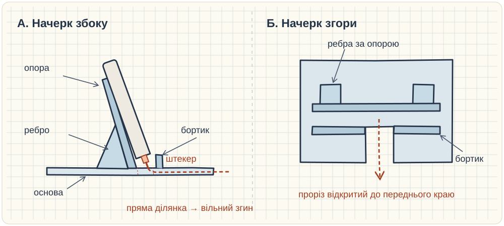
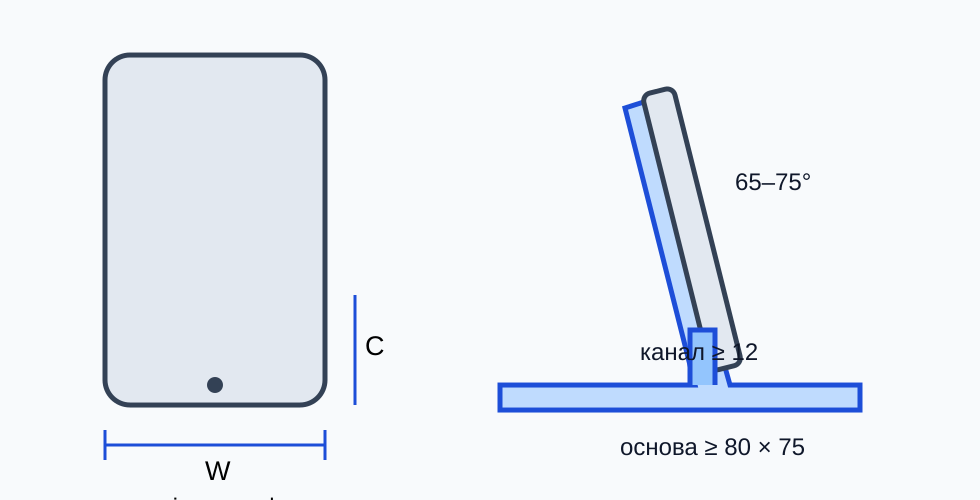

# Урок 12. Проєктування тримача телефона

## Мета та результат

Навчитися починати проєкт не з випадкової 3D-форми, а з аналізу потреб, вимірювань і перевірюваних вимог. Наприкінці уроку учень або учениця має підготувати погоджений розмірний ескіз настільного тримача, за яким на наступному занятті можна створити модель.

Тримач повинен утримувати телефон у вертикальному положенні, не перекривати екран, не заважати кабелю живлення та мати достатню опорну площу. Конструкція розрахована на один конкретний телефон у чохлі або без нього — це потрібно визначити до вимірювань.

## Перший крок — скетч на папері

Від руки намалюйте тримач збоку та згори. Позначте основу, нерухому опору, бортик, телефон і шлях кабелю. На бічному вигляді намалюйте вставлений штекер і пряму жорстку ділянку біля нього. Позначте за опорою місця для ребер жорсткості. Цей скетч потрібен, щоб зрозуміти конструкцію перед вимірюванням і побудовою в Fusion. Розміри додасте після вимірювання.

*Рисунок 1. Приклади начерків на папері в клітинку. Збоку видно штекер і пряму ділянку кабелю, згори — ребра жорсткості та відкритий проріз. Пунктир показує шлях гнучкої частини кабелю.*

## Вимірювання телефона

Виміряйте ширину **W**, товщину **T** і відстань **C** від лівого краю телефона до центра нижнього роз’єму, якщо дивитися на екран. Якщо використовуєте чохол, вимірюйте разом із ним. Для напису на тримачі запишіть назву моделі телефона.

*Рисунок 2. Розміри телефона й два вигляди нерухомого тримача. Канал показано для роз’єму посередині.*

Вставте штекер у телефон з боку нижнього роз’єму. Виміряйте ширину й товщину його корпусу та виліт від нижнього краю телефона до місця, з якого кабель починає вільно згинатися. Цей виліт включає корпус штекера й жорстку ділянку біля нього.

До кожного розміру, що визначає посадку, додають зазор. Для навчального макета прийміть бічний зазор 1 мм з кожного боку й зазор за товщиною 1 мм. Тоді ширина посадочного місця дорівнює **W + 2 мм**, а його глибина — **T + 1 мм**.

## Вимоги до конструкції

| Властивість | Перевірювана вимога |
| --- | --- |
| Посадка | телефон входить без натиску й не випадає вперед |
| Кут огляду | нерухома задня опора без шарнірів нахилена на 65–75° до основи |
| Передній бортик | висота 10–14 мм; не перекриває значну частину екрана |
| Основа | не менше 80 мм завширшки й 75 мм завглибшки |
| Канал кабелю | ширина не менше 12 мм; узгоджений із роз’ємом, пропускає штекер і жорстку ділянку кабелю без натягу |
| Товщина стінок | не менше 4 мм у навчальній моделі |
| Краї | доступні зовнішні ребра без небезпечних гострих кутів |

Ці значення є навчальними. Якщо виміряний кабель або телефон потребує більшого зазору, у таблиці проєкту запишіть власне обґрунтоване значення.

## Аналіз стійкості

Телефон тисне на опорну поверхню та намагається перекинути тримач назад. Чим вищий і важчий телефон, тим важливіша глибина основи. У спрощеній перевірці вертикальна проєкція приблизного центра телефона повинна потрапляти всередину контуру основи.

Намалюйте на бічному ескізі прямокутник телефона в робочому положенні. Позначте його приблизний центр і проведіть вертикаль униз. Якщо лінія виходить за задню межу основи, збільште глибину, зменште кут нахилу або змініть положення опори.

Не слід покладатися лише на збільшення товщини. Масивна, але коротка основа може залишатися нестійкою, тоді як правильно розміщена широка опора працює краще.

## Тест перед практичною роботою № 5

Після розбору вимог до тримача й перед уточненням розмірного ескізу пройдіть тест у Moodle. Файл для імпорту запитань — [Тест за матеріалами уроку 12](../../Тести/test-less-12/test-less-12.gift).

## Хід уроку

### 1. Формулювання сценарію

Запишіть, де використовуватиметься тримач: на столі, для перегляду відео або під час заряджання. Визначте орієнтацію — вертикальну; наявність чохла; потребу в підключеному кабелі. Від цих рішень залежать зазори й форма каналу.

Складіть короткий список: «Тримач повинен…». Кожне твердження має бути таким, щоб його можна було перевірити вимірюванням або оглядом.

### 2. Таблиця вихідних даних

Запишіть W, T і C в міліметрах. Додайте до таблиці ширину, товщину й виліт під’єднаного штекера разом із жорсткою ділянкою. Розрахуйте ширину посадочного місця **W + 2 мм** і глибину **T + 1 мм**.

Перевірте одиниці вимірювання. Не змішуйте сантиметри й міліметри. Значення округлюйте до 0,5 мм лише тоді, коли точність вимірювального інструмента це дозволяє.

### 3. Бічний ескіз

Намалюйте основу завглибшки не менше 75 мм. Додайте задню опору під кутом 70° до основи та передній бортик заввишки 12 мм. Покажіть умовний телефон прямокутником завтовшки T і перевірте зазор. Покажіть, чи вистачає висоти й довжини отвору для вставляння та виймання штекера. Якщо кабель упирається в основу або стіл, змініть вихід каналу чи висоту посадки й повторно перевірте стійкість.

Позначте товщину опори 4 мм і плавний перехід до основи. На цьому етапі не потрібно деталізувати скруглення: достатньо вказати майбутній радіус R3–R5 у примітці.

### 4. Вид зверху

Побудуйте прямокутну основу. Її ширина має бути не меншою за W + 20 мм, але не меншою за 80 мм. Розташуйте посадочне місце по центру. Сумістіть вісь каналу з роз’ємом за розміром C. Покажіть відкритий вихід до переднього краю. Ширина каналу має становити щонайменше 12 мм і перевищувати ширину штекера щонайменше на 2 мм.

Перевірте, чи не перетинає канал основні опорні ділянки. Ліворуч і праворуч від нього мають залишатися перемички не менше 8 мм.

### 5. Узгодження видів

Звірте бічний вид і вид зверху. На бічному виді звірте положення опори й бортика. На вигляді згори перевірте ширину та положення каналу. Пронумеруйте ключові розміри й перенесіть їх у таблицю.

Укажіть, які операції Fusion плануються: Extrude для основи, Extrude або профіль для задньої опори, Cut для каналу, Fillet і Chamfer для країв. Це ще не послідовність натискання команд, а план побудови.

### 6. Перевірка проєкту

Обміняйтеся ескізами в парі. Партнер має відповісти на три питання: чи поміститься телефон, чи доступний роз’єм і чи достатня опорна площа. Зауваження перевірте за розмірами, після чого виправте ескіз або аргументовано залиште рішення.

Погоджений варіант стане джерелом істини для уроку 13. Зміни під час моделювання потрібно буде записати й пояснити.

## Типові помилки

- телефон виміряно без чохла, хоча тримач планується використовувати з ним;
- посадочне місце дорівнює точній товщині без зазору;
- канал вужчий за штекер або не доходить до краю;
- передній бортик перекриває екран чи кнопку;
- види мають суперечливі розміри;
- стійкість оцінено лише за зовнішнім виглядом;
- ескіз містить форму, але не містить числових вимог.

## Перевірка результату

- підготовлено паперовий скетч і визначено сценарій використання та наявність чохла;
- записано W, T, C, габарити штекера й виліт жорсткої ділянки кабелю;
- розраховано посадочні зазори;
- підготовлено узгоджені бічний вид і вид зверху;
- показано основу, задню опору, бортик і канал кабелю;
- перевірено положення умовного центра телефона над основою;
- складено план операцій для наступного уроку.

## Підготовка до практичної роботи № 5

Погодьте сценарій використання, розміри телефона з чохлом і штекера та два узгоджені види тримача. Збережіть ескізи з розмірами для одного підсумкового звіту. Умови завершення наведено в [уроці 13](../less-13/README.md#практична-робота--5).

## Навігація

[До тематичного плану](../../README.md) · [Попередній урок](../less-11/README.md) · [Наступний урок](../less-13/README.md)
