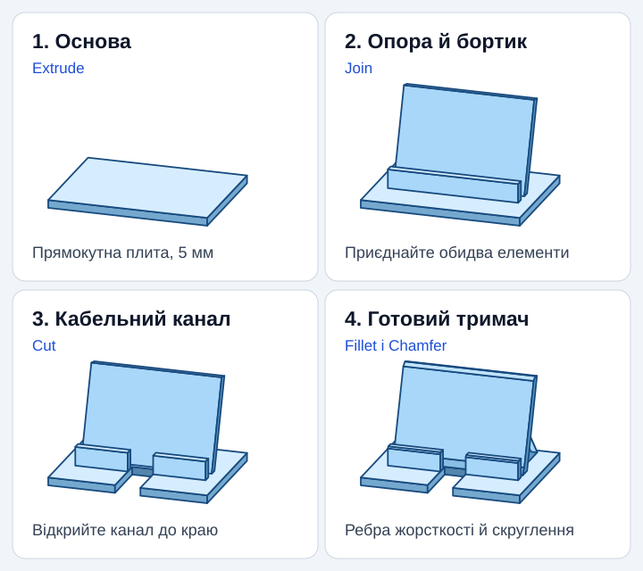

# Урок 13. Моделювання тримача телефона

## Практична робота № 5

**Тримач телефона без шарнірів**

### Тема, час і мета

**Орієнтовний час:** 45 хвилин.

Закріпіть побудову цілісної моделі у Fusion.

Вихідними даними є власна таблиця вимірів: ширина телефона W, товщина T, положення роз’єму C, габарити штекера й виліт жорсткої ділянки кабелю.

### Завдання

За [ескізом уроку 12](../less-12/README.md) змоделюйте тримач без шарнірів, нанесіть власний логотип і назву моделі телефона. Перевірте посадку й доступ до роз’єму.

### Будова моделі

*Рисунок 1. Основа, задня опора й бортик, виріз каналу, ребра жорсткості та обробка країв.*

| Елемент | Параметр |
| --- | --- |
| Основа | ширина не менше max(W + 20; 80), глибина не менше 75, товщина 5 мм |
| Задня опора | кут 65–75°, товщина не менше 4 мм |
| Посадочна глибина | T + 1 мм |
| Передній бортик | висота 10–14 мм; товщина 4 мм |
| Канал кабелю | ширина щонайменше 12 мм і щонайменше на 2 мм більша за ширину штекера |
| Бічні перемички каналу | не менше 8 мм |
| Ребра жорсткості | два трикутні ребра за опорою, приєднані до опори й основи |
| Скруглення | R3–R5 на переході опори до основи, якщо геометрія дозволяє |
| Фаски | 0,5–1 мм на доступних зовнішніх ребрах |

### План історії

Запишіть виміряні й розраховані розміри перед побудовою.

Спочатку побудуйте основу, опору й бортик. Далі виріжте канал, додайте ребра жорсткості, обробіть краї та нанесіть логотип і напис.

### Послідовність виконання

#### 1. Компонент і параметри

Створіть компонент «Тримач телефона». Розміри вводьте за таблицею або задайте параметри W, T, BaseWidth, SlotDepth і CableWidth у міліметрах через **Modify → Change Parameters**.

BaseWidth має дорівнювати погодженій ширині основи, SlotDepth — T + 1 мм, CableWidth — ширині штекера + 2 мм. Не додавайте одиниці до назви параметра: одиницю задають у відповідному полі.

#### 2. Основа

На площині XY побудуйте центральний прямокутник BaseWidth × 75 мм або більшої погодженої глибини. Витягніть його на 5 мм як **New Body**. Назвіть ескіз «Контур основи», а операцію — «Основа 5 мм».

За кубом виду визначте передній край. Збережіть нижню грань плоскою.

#### 3. Задня опора та бортик

Створіть ескіз на центральній вертикальній площині. Спроєктуйте верхню грань основи та побудуйте бічний профіль: задню опору завтовшки не менше 4 мм під погодженим кутом, посадочне місце глибиною SlotDepth і передній бортик 10–14 мм.

Замкніть профіль і витягніть його симетрично на ширину посадочного місця W + 2 мм з операцією **Join**. Якщо за ескізом опора має ширину всієї основи, використайте BaseWidth, але залиште майбутній канал і доступ до кнопок.

Після операції в браузері має залишитися одне тіло. Перевірте бічний вигляд: умовний прямокутник телефона повинен спиратися на посадочну поверхню й задню опору, а бортик — утримувати нижній край.

#### 4. Канал для кабелю

На верхній або передній грані створіть ескіз каналу шириною CableWidth, сумістивши його вісь із центром роз’єму за розміром C. Він має проходити від посадочного місця до переднього краю. Виконайте **Extrude → Cut → Through All** для ділянки основи, яку потрібно відкрити.

Перевірте ширину перемичок ліворуч і праворуч: кожна не менша за 8 мм. Якщо канал перетинає бортик, сформуйте в ньому відповідний отвір тим самим або окремим контрольованим вирізом.

#### 5. Ребра жорсткості та скруглення

Побудуйте за опорою бічний ескіз трикутного ребра. Його профіль має заходити в основу й задню опору, щоб вони об’єдналися. Витягніть ребро з **Join**, орієнтовна товщина — 4 мм. Повторіть його з іншого боку опори, залишивши вільними посадочне місце та шлях кабелю. Ребра зменшують прогин опори під навантаженням і передають зусилля на основу.

Додайте Fillet R3–R5 у місці переходу задньої опори до основи. Почніть із малого радіуса й збільшуйте лише після успішного попереднього перегляду. За наявності місця додайте менші скруглення біля ребер. Перевірте SlotDepth, товщину стінок і плоску нижню грань.

Застосуйте Chamfer 0,5–1 мм до зовнішніх ребер бортика й основи, яких торкається користувач. Не створюйте фаску на нижній опорній площині, якщо вона помітно зменшує площу контакту зі столом.

#### 6. Нанесення логотипа й назви моделі

На видимій плоскій ділянці створіть ескіз. Через **Insert SVG** вставте власний логотип з [уроку 6](../less-06/README.md#практична-робота--2) і перевірте замкненість його контурів. Командою **Text** додайте назву моделі телефона, для якої зроблено тримач. Витягніть контури через **Join** для рельєфу або **Cut** для заглиблення. Перевірте читабельність і залиште вільними посадочне місце, канал і нижню опорну площину.

#### 7. Цифрова перевірка посадки й кабелю

Створіть просте контрольне тіло телефона — прямокутний паралелепіпед W × T із довільною достатньою висотою. Розмістіть його в посадочному місці лише для перевірки. Покажіть штекер і жорстку ділянку простими допоміжними тілами за вимірами уроку 12. У бічному вигляді перевірте їх у під’єднаному положенні та під час прямого вставляння і виймання. Вони не повинні торкатися бортика, ребер, основи або площини стола.

Після перевірки приховайте або видаліть допоміжні тіла телефона й штекера.

#### 8. Звірення з проєктом

Через Measure перевірте габарити основи, SlotDepth, висоту бортика, ширину каналу й товщину опори. Порівняйте їх із таблицею уроку 12. Якщо розмір змінено, запишіть старе й нове значення та коротко поясніть причину.

Огляньте модель знизу, спереду, збоку й у перспективі. Переконайтеся, що тримач є одним тілом, нижня площина рівна, канал відкритий, а на шкалі історії немає помилок.

### Ризики друку довгої основи на FDM-принтері

Довга пласка основа може деформуватися через нерівномірне охолодження й усадку. Якщо кути відриваються від платформи, готовий тримач може хитатися. У слайсері перевірте, чи модель поміщається на платформі разом із полями та, за потреби, каймою (brim). Для першої перевірки розташуйте основу пласкою гранню до столу принтера й перегляньте перший шар і ділянки навколо каналу. Використайте перевірений профіль принтера й матеріалу. Кайма збільшує площу прилягання першого шару. [Довідка Prusa про деформацію під час друку](https://help.prusa3d.com/article/warping_2011)

### Що подати на перевірку

- звіт у форматі Markdown або PDF;
- пронумеровані скріншоти основи, підсилення, перевірки посадки зі штекером, нанесення логотипа й напису та готової моделі;
- перелік змін відносно ескізу уроку 12 з коротким поясненням.

Під кожним скріншотом поясніть дію, видимі параметри й результат. Останній скріншот має показувати повний тримач у перспективі.

### Типові помилки

- розміри моделі не відповідають погодженому ескізу;
- опора або бортик створені як окремі тіла;
- посадочне місце не враховує товщину чохла;
- канал закритий з переднього боку або вужчий за штекер;
- скруглення руйнує тонку стінку;
- контрольне тіло телефона випадково об’єднано з тримачем;
- нижню грань оброблено так, що модель хитається.

### Критерії оцінювання

| Критерій | Бали |
| --- | ---: |
| Відповідність погодженим розмірам | 2 |
| Цілісні основа, опора, бортик і ребра жорсткості | 3 |
| Посадочні зазори та цифрова перевірка | 2 |
| Кабельний канал і вільне вставляння штекера | 2 |
| Обробка країв, читабельний логотип і назва моделі, повний звіт | 2 |
| **Разом за обов’язкові вимоги** | **11** |

12-й бал нараховується за доречне використання можливості або прийому, якого не розглядали у відповідних уроках. У звіті потрібно назвати цю можливість, пояснити, чому її не охоплювали відповідні уроки і як вона покращила спосіб або якість роботи і зазначити номер скріншота-доказу. Без текстового обґрунтування творчий бал не нараховується.

### Правила виконання

Виконуйте роботу самостійно за власними вимірами. Дозволено користуватися матеріалами уроків та офіційною довідкою Autodesk.

## Навігація

[До тематичного плану](../../README.md) · [Попередній урок](../less-12/README.md) · [Наступний урок](../less-14/README.md)
