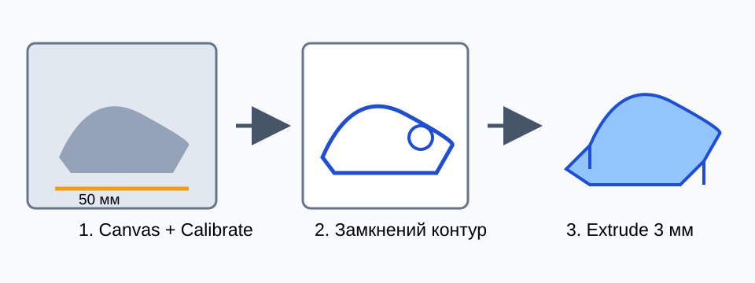

# Урок 14. Моделювання за фотографією: масштаб і контури

## Мета та результат

Навчитися використовувати фотографію як візуальну основу для ескізу: обирати придатний ракурс, калібрувати зображення за відомим розміром, відтворювати головні контури та перевіряти модель вимірюваннями. Результат уроку — спрощена плоска модель предмета, побудована за одним фото.

Фотографія не є точним кресленням. Перспектива, нахил камери й оптичні спотворення змінюють видимі пропорції. Тому з фото беруть загальну форму, а точний масштаб задають лише за відомим контрольним розміром.

## Підготовка вихідного зображення

Для навчальної роботи оберіть власне фото простого плоского предмета: ключа, бирки, відкривачки або деталі з чітким силуетом. Предмет має повністю потрапити в кадр, лежати на контрастному фоні, а камера — бути спрямована приблизно перпендикулярно до його площини. Поряд покладіть лінійку або інший об’єкт із відомим розміром.

> TODO: вставити власну фотографію предмета з контрольним відрізком і підписом про автора зображення.

Не використовуйте випадкове фото з невідомою ліцензією. Для власного зображення в підписі достатньо зазначити, що його зробив виконавець роботи.

## Від фото до моделі

*Рисунок 1. Спочатку зображення калібрують за відомим відрізком, потім будують спрощений замкнений контур і лише після цього створюють об’єм.*

| Етап | Результат |
| --- | --- |
| Вставлення Canvas | фото закріплене на вибраній площині |
| Calibrate | відстань між двома точками відповідає відомому розміру |
| Ескіз | основний силует передано відрізками, дугами та сплайнами |
| Розміри | ключові відстані задаються чисельно, а не «на око» |
| Extrude | замкнений профіль перетворено на тіло заданої товщини |
| Measure | контрольний габарит моделі звірено з вихідними даними |

## Навчальне завдання

Побудуйте модель плоскої бирки за власною фотографією. Відомий контрольний розмір — найбільша довжина предмета, яку потрібно виміряти лінійкою до початку роботи. Товщина навчальної моделі становить 3 мм. Якщо на предметі є отвір, виміряйте його діаметр окремо; не визначайте точний діаметр лише за пікселями фото.

Контур потрібно спростити: дрібні подряпини, нерівності та відблиски не переносять в ескіз. Симетричні частини доцільно будувати геометрично, навіть якщо на фотографії вони здаються трохи різними.

## Хід уроку

### 1. Вставлення Canvas

Створіть компонент «Модель за фото». Виберіть площину, що відповідає виду зверху, та скористайтеся **Insert → Canvas**. Укажіть файл, розмістіть його в центрі площини й підтвердьте вставлення. Canvas з’явиться в браузері в окремій папці.

Зменште непрозорість зображення так, щоб майбутні лінії ескізу добре читалися. Не змінюйте масштаб довільним перетягуванням після калібрування.

### 2. Калібрування масштабу

У браузері відкрийте контекстне меню Canvas і виберіть **Calibrate**. Послідовно вкажіть дві точки на кінцях відомого відрізка — наприклад, поділки 0 і 50 мм на лінійці. Введіть реальне значення 50 мм.

Після калібрування виміряйте видиму загальну довжину предмета. Вона має бути близькою до виміряної фізично. Невелика розбіжність можлива через неточний вибір пікселів; значна розбіжність означає помилку калібрування або перспективне спотворення.

### 3. Побудова головного контуру

Створіть ескіз на тій самій площині. Почніть із прямих ділянок і простих дуг. Для плавної нерегулярної межі використайте мінімальну кількість контрольних точок сплайна: надлишок точок створює хвилястий контур, який важко редагувати.

Не обводьте кожний піксель. Виділяйте конструктивні ознаки: вісь симетрії, центри кіл, дотичні переходи, паралельні краї. Якщо ліва й права частини симетричні, побудуйте половину та використайте Mirror.

### 4. Числові розміри

Задайте ескізу найбільшу довжину за фізичним вимірюванням. Додайте ширину, діаметр отвору й відступ його центра від краю. Геометрія має набувати визначеності завдяки розмірам та обмеженням, а фотографія залишається лише орієнтиром.

Якщо числовий розмір відводить лінію від видимого краю фото, довіряйте вимірюванню. Розбіжність свідчить про перспективу або спотворення зображення.

### 5. Створення моделі

Переконайтеся, що зовнішній контур замкнений, а отвори утворюють окремі внутрішні профілі. Завершіть ескіз і витягніть зовнішню область на 3 мм як **New Body**. Внутрішній отвір не повинен заповнитися; за потреби виконайте його окремим Cut Through All.

Приховайте Canvas і порівняйте чистий силует моделі з фотографією. Застосуйте невелике Fillet лише там, де воно передає справді округлений край, а не випадкову тінь.

### 6. Оцінювання точності

Перевірте найбільшу довжину, ширину, товщину та діаметр отвору через Measure. Запишіть, які розміри були виміряні на предметі, а які лише наближено відтворені за фото.

Одне фронтальне зображення не дає надійної інформації про глибину, форму зворотного боку та приховані елементи. Товщину 3 мм у цій роботі задано умовою. Для точнішого відновлення потрібні додаткові ракурси або креслення.

## Типові помилки

- фото зроблено під значним кутом або без контрольного розміру;
- Canvas масштабовано вручну після Calibrate;
- контур повторює шум, відблиски та подряпини;
- сплайн містить надто багато точок;
- усі розміри визначаються за пікселями без фізичних вимірювань;
- відкритий контур не утворює профіль для Extrude;
- за одним фото вигадано невидиму форму зворотного боку.

## Перевірка результату

- Canvas вставлено на правильну площину й відкалібровано;
- в ескізі відтворено головний, а не випадковий контур;
- контрольні розміри задано чисельно;
- модель має товщину 3 мм і правильні отвори;
- найбільший габарит відповідає фізичному вимірюванню;
- учень або учениця називає щонайменше два обмеження моделювання за одним фото.

## Довідка

- [Вставлення зображення Canvas — Autodesk](https://help.autodesk.com/cloudhelp/ENU/Fusion-Model/files/SLD-INSERT-CANVAS.htm).
- [Калібрування Canvas — Autodesk](https://help.autodesk.com/cloudhelp/ENU/Fusion-Model/files/SLD-CALIBRATE-CANVAS.htm).

## Тест перед практичною роботою № 6

Після тренувального моделювання за фото й перед аналізом стели пройдіть тест у Moodle. Файл для імпорту запитань — [Тест за матеріалами уроку 14](../../Тести/test-less-14/test-less-14.gift).

## Підготовка до практичної роботи № 6

На наданому фото стели або на навчальній схемі уроку 15 позначте основу, вертикальну пластину, верхній скіс і ділянку напису. Збережіть скріншот аналізу. Калібруйте Canvas за наявності підтвердженого контрольного розміру. Умови завершення наведено в [уроці 15](../less-15/README.md#практична-робота--6).

## Навігація

[До тематичного плану](../../README.md) · [Попередній урок](../less-13/README.md) · [Наступний урок](../less-15/README.md)
