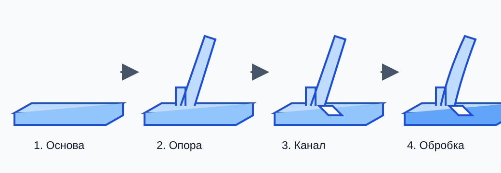

# Урок 15. Моделювання тримача телефона

## Тема, час і мета

**Орієнтовний час:** 45 хвилин.

Практична робота № 5 завершує проєкт тримача, розпочатий на уроці 14. Потрібно перенести погоджені розміри у Fusion, створити цілісну модель, перевірити посадочне місце, стійкість і доступ до зарядного роз’єму, а також пояснити зміни відносно початкового ескізу.

Вихідними даними є власна таблиця вимірів: ширина телефона W, товщина T, положення роз’єму C та розмір штекера. Якщо ескіз не погоджено або в ньому бракує значень, спочатку завершіть урок 14.

## Будова моделі

*Рисунок 1. Основні операції: основа, задня опора й бортик, виріз каналу, обробка ребер.*

| Елемент | Параметр |
| --- | --- |
| Основа | ширина не менше max(W + 20; 80), глибина не менше 75, товщина 5 мм |
| Задня опора | кут 65–75°, товщина не менше 4 мм |
| Посадочна глибина | T + 1 мм |
| Передній бортик | висота 10–14 мм; товщина 4 мм |
| Канал кабелю | ширина не менше ширини штекера + 2 мм |
| Бічні перемички каналу | не менше 8 мм |
| Скруглення | R3–R5 на переході опори до основи, якщо геометрія дозволяє |
| Фаски | 0,5–1 мм на доступних зовнішніх ребрах |

## План історії

Перед побудовою визначте незалежні й залежні розміри. W і T отримано вимірюванням; ширина посадки обчислюється з W; ширина основи залежить від W, але має мінімум 80 мм. Запишіть прийняті значення в таблицю, щоб під час моделювання не замінювати їх випадковими числами.

Рекомендований порядок: параметри й ескіз основи → Extrude основи → ескіз бічного профілю → Extrude опори та бортика → Cut каналу → Fillet і Chamfer → вимірювання. Назви операцій мають описувати результат.

## Послідовність виконання

### 1. Компонент і параметри

Створіть компонент «Тримач телефона». За можливості відкрийте **Modify → Change Parameters** і створіть користувацькі параметри W, T, BaseWidth, SlotDepth і CableWidth у міліметрах. Якщо параметри ще не використовувалися на уроках, дозволено вводити значення безпосередньо за таблицею.

BaseWidth має дорівнювати погодженій ширині основи, SlotDepth — T + 1 мм, CableWidth — ширині штекера + 2 мм. Не додавайте одиниці до назви параметра: одиницю задають у відповідному полі.

### 2. Основа

На площині XY побудуйте центральний прямокутник BaseWidth × 75 мм або більшої погодженої глибини. Витягніть його на 5 мм як **New Body**. Назвіть ескіз «Контур основи», а операцію — «Основа 5 мм».

Перевірте нижню грань: вона має залишитися плоскою. Передній і задній краї визначте за кубом виду, щоб не розгорнути конструкцію в протилежний бік.

### 3. Задня опора та бортик

Створіть ескіз на центральній вертикальній площині. Спроєктуйте верхню грань основи та побудуйте бічний профіль: задню опору завтовшки не менше 4 мм під погодженим кутом, посадочне місце глибиною SlotDepth і передній бортик 10–14 мм.

Замкніть профіль і витягніть його симетрично на ширину посадочного місця W + 2 мм з операцією **Join**. Якщо за ескізом опора має ширину всієї основи, використайте BaseWidth, але залиште майбутній канал і доступ до кнопок.

Після операції в браузері має залишитися одне тіло. Перевірте бічний вигляд: умовний прямокутник телефона повинен спиратися на посадочну поверхню й задню опору, а бортик — утримувати нижній край.

### 4. Канал для кабелю

На верхній або передній грані створіть ескіз симетричного каналу шириною CableWidth. Він має проходити від посадочного місця до переднього краю. Виконайте **Extrude → Cut → Through All** для ділянки основи, яку потрібно відкрити.

Перевірте ширину перемичок ліворуч і праворуч: кожна не менша за 8 мм. Якщо канал перетинає бортик, сформуйте в ньому відповідний отвір тим самим або окремим контрольованим вирізом.

### 5. Обробка переходів

Додайте Fillet R3–R5 у місці переходу задньої опори до основи. Почніть із малого радіуса й збільшуйте лише після успішного попереднього перегляду. Скруглення не повинно звужувати посадочне місце нижче SlotDepth.

Застосуйте Chamfer 0,5–1 мм до зовнішніх ребер бортика й основи, яких торкається користувач. Не створюйте фаску на нижній опорній площині, якщо вона помітно зменшує площу контакту зі столом.

### 6. Цифрова перевірка посадки

Створіть просте контрольне тіло телефона — прямокутний паралелепіпед W × T із довільною достатньою висотою. Розмістіть його в посадочному місці лише для перевірки. Між ним і стінками мають залишатися задані зазори, а канал має збігатися з положенням роз’єму.

Контрольне тіло не є частиною готового тримача. Після перевірки приховайте або видаліть тільки це допоміжне тіло, не торкаючись основної моделі. У фінальному браузері чітко відрізняйте тримач від перевірного об’єкта.

### 7. Звірення з проєктом

Через Measure перевірте габарити основи, SlotDepth, висоту бортика, ширину каналу й товщину опори. Порівняйте їх із таблицею уроку 14. Якщо розмір змінено, запишіть старе й нове значення та коротко поясніть причину.

Огляньте модель знизу, спереду, збоку й у перспективі. Переконайтеся, що тримач є одним тілом, нижня площина рівна, канал відкритий, а на шкалі історії немає помилок.

## Що подати на перевірку

- звіт у форматі Markdown або PDF;
- пронумеровані скріншоти основи, профілю опори, каналу, цифрової перевірки телефона й готової моделі;
- таблицю «Вимога», «Виконано», «Доказ» із номерами скріншотів;
- перелік змін відносно ескізу уроку 14 з коротким поясненням.

Під кожним скріншотом має бути змістовний підпис. Важливі параметри й розміри повинні читатися. Останній скріншот показує повний тримач у перспективі без прихованих частин основної моделі.

## Типові помилки

- розміри моделі не відповідають погодженому ескізу;
- опора або бортик створені як окремі тіла;
- посадочне місце не враховує товщину чохла;
- канал закритий з переднього боку або вужчий за штекер;
- скруглення руйнує тонку стінку;
- контрольне тіло телефона випадково об’єднано з тримачем;
- нижню грань оброблено так, що модель хитається.

## Критерії оцінювання

| Критерій | Бали |
| --- | ---: |
| Відповідність погодженим розмірам | 2 |
| Цілісні основа, опора й бортик | 3 |
| Посадочні зазори та цифрова перевірка | 2 |
| Доступний кабельний канал | 2 |
| Обробка країв і повний звіт | 2 |
| **Разом за обов’язкові вимоги** | **11** |

12-й бал нараховується за доречне використання можливості або прийому, якого не розглядали у відповідних уроках. У звіті потрібно назвати цю можливість, пояснити новизну та практичну користь і зазначити номер скріншота-доказу. Додаткова дія без впливу на якість не зараховується.

## Правила виконання

Виконуйте роботу самостійно за власними вимірами й погодженим ескізом. Дозволено користуватися матеріалами уроків та офіційною довідкою Autodesk. Не копіюйте готову модель іншого виконавця.

## Навігація

[До тематичного плану](../../README.md) · [Попередній урок](../less-14/README.md)
