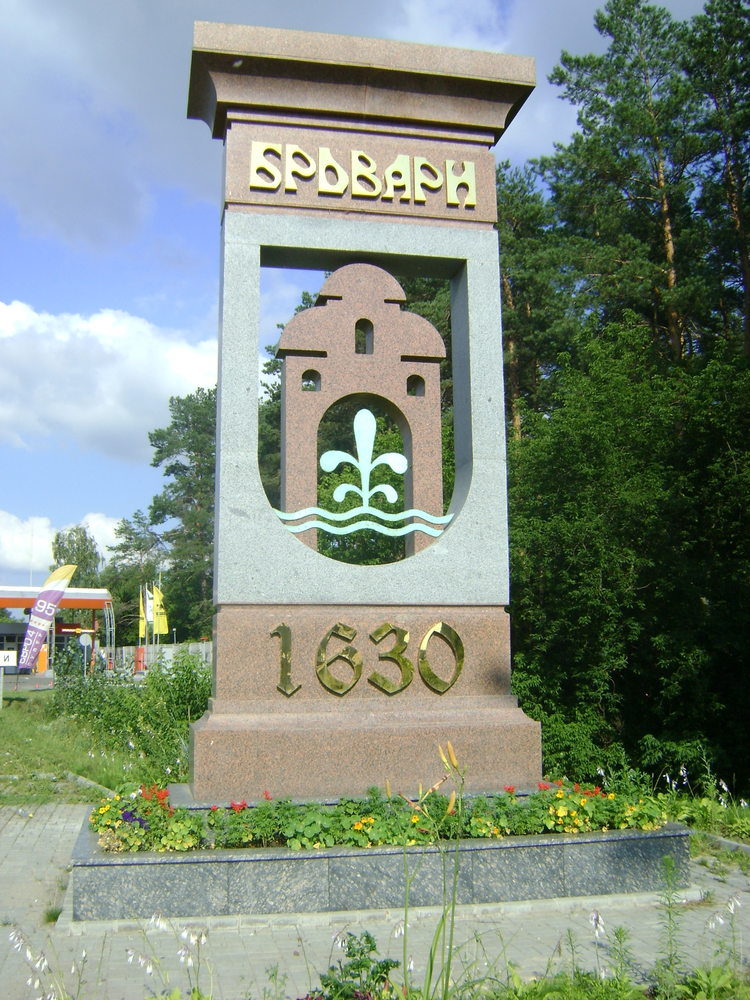
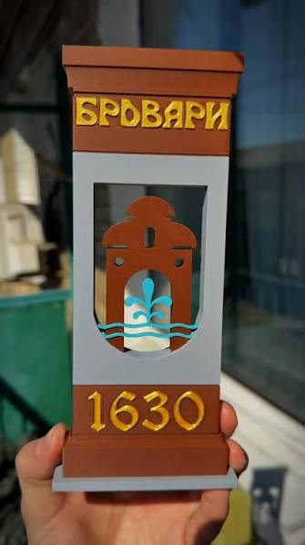

# Урок 15. Спрощений макет стели «Бровари»

## Практична робота № 6

**Спрощений макет стели «Бровари»**

### Тема, час і мета

**Орієнтовний час:** 45 хвилин.

Практична робота № 6 присвячена переходу від фотографій реального об’єкта до спрощеного навчального макета. Учень або учениця має виділити головні геометричні форми, прийняти умовні розміри, побудувати стійку композицію та пояснити, які деталі свідомо не відтворювалися.

Робота не претендує на точну реконструкцію стели або офіційне відтворення її оформлення. Без обмірів і кількох ортогональних зображень справжні розміри визначити неможливо.

### Завдання

За фото стели з [уроку 14](../less-14/README.md) побудуйте цілісний макет зі ступінчастою основою, високою рамою, центральним наскрізним прорізом, горизонтальним карнизом і написом «БРОВАРИ» над прорізом. Якщо відомий контрольний розмір оригіналу, відкалібруйте Canvas. Для навчальної моделі використовуйте розміри з таблиці.

### Вихідні матеріали

*Рисунок 1. Реальна стела «Бровари». Зверніть увагу на основу, верхній напис і центральний проріз із декоративними деталями. Фото надано для уроку.*

*Рисунок 2. Приклад стели «Бровари», виготовленої на 3D-принтері. Порівняйте з оригіналом форму основи, прорізу й написів. Фото надано для уроку.*

### Умовні розміри макета

Наведені значення стосуються лише навчальної моделі й не описують фактичні розміри реального об’єкта.

| Елемент | Розмір |
| --- | --- |
| Основа | 120 × 50 × 8 мм |
| Нижня сходинка | 96 × 26 × 6 мм, по центру основи |
| Вертикальна рама | 90 × 12 × 150 мм над нижньою сходинкою |
| Наскрізний проріз | 60 × 90 мм, по центру рами; нижній край на висоті 20 мм від низу рами |
| Верхній карниз | 100 × 20 × 8 мм, по центру верхньої грані рами |
| Напис «БРОВАРИ» | висота символів 9–11 мм; виступ 1 мм |
| Скруглення основи | R4 на чотирьох вертикальних ребрах |
| Фаска рами | 1 мм на доступних зовнішніх ребрах |

### Послідовність виконання

#### 1. Аналіз і спрощення

Порівняйте фото реальної стели та надрукованого зразка. На окремому аркуші або в ескізі позначте три рівні форми: головні об’єми, помітні декоративні елементи та дрібні деталі. До моделі обов’язково переносяться головні об’єми; декоративні — лише якщо вони впливають на впізнаваність; дрібні деталі пропускаються.

На фото видно горизонтальний карниз, напис, високу раму з округленим низом прорізу та нижній ступінчастий цоколь. Похилі лінії на фото виникають через ракурс. У навчальному макеті передайте ці форми. Внутрішній силует, хвилі та інші дрібні деталі можна спростити.

#### 2. Основа макета

Створіть компонент «Стела Бровари — навчальний макет». На площині XY побудуйте центральний прямокутник 120 × 50 мм і витягніть його на 8 мм як **New Body**. Застосуйте Fillet R4 до чотирьох вертикальних ребер.

Перевірте, що нижня грань лишилася плоскою. Макет повинен упевнено стояти на основі, тому не скруглюйте нижній периметр великим радіусом.

#### 3. Нижня сходинка, рама й карниз

На основі побудуйте нижню сходинку 96 × 26 мм і витягніть на 6 мм із **Join**. По її центру побудуйте прямокутник 90 × 12 мм і витягніть на 150 мм із **Join**. На верхній грані додайте горизонтальний карниз 100 × 20 × 8 мм із **Join**. Виступ карниза має бути симетричним.

#### 4. Наскрізний проріз

На фронтальній грані рами побудуйте контур у межах 60 × 90 мм. Його нижній край розташуйте за 20 мм від низу рами. Верх залиште прямим, а два нижні кути заокругліть дугами, наприклад R20. Виберіть замкнений профіль і виконайте **Extrude → Cut → Through All** у напрямку крізь товщину рами. Перевірте, що проріз оточений суцільним матеріалом.

#### 5. Напис

На смузі над прорізом створіть ескіз. Додайте напис «БРОВАРИ» напівжирним шрифтом заввишки 9–11 мм, розташуйте по центру й витягніть на 1 мм назовні з **Join**. Залиште проміжки довкола напису й перевірте читабельність. За бажанням додайте «1630» на нижній ділянці передньої грані.

#### 6. Завершальна обробка

Застосуйте Chamfer 1 мм до доступних зовнішніх ребер рами, якщо зберігаються цілісність стінок і читабельність напису. Не обробляйте ребра, які зникають у місці з’єднання з основою.

Огляньте макет у фронтальному, бічному та перспективному видах. Перевірте габарити, симетрію, стійкість і цілісність. У браузері має бути одне тіло.

### Що подати на перевірку

- звіт у форматі Markdown або PDF;
- пронумеровані скріншоти аналізу форми, основи, рами з прорізом, карниза з написом і повного результату.

Під кожним скріншотом потрібен змістовний підпис із назвою виконаної дії, важливими параметрами та отриманим результатом. На останньому скріншоті покажіть повний макет у перспективі. Зазначте, яке джерело використано та які деталі спрощено.

### Типові помилки

- перспективний вигляд фото помилково сприймається як точне креслення;
- до моделі додаються непідтверджені реальні розміри;
- рама або карниз лишаються окремими тілами;
- центральний проріз не проходить крізь усю раму;
- текст виходить за межі верхньої смуги або має надто тонкі штрихи;
- великі фаски змінюють характерний силует;
- дрібні декоративні деталі відволікають від головних пропорцій.

### Критерії оцінювання

| Критерій | Бали |
| --- | ---: |
| Аналіз і обґрунтоване спрощення форми | 2 |
| Основа, сходинка та рама заданих розмірів | 3 |
| Проріз, горизонтальний карниз і читабельний напис | 3 |
| Цілісність, обробка ребер і перевірка габаритів | 1 |
| Повний звіт із доказами | 2 |
| **Разом за обов’язкові вимоги** | **11** |

12-й бал передбачено за доречний творчий прийом або можливість, якої не розглядали на відповідних уроках. У звіті назвіть прийом, поясніть, чому його не охоплювали відповідні уроки і як він покращив виконання, наведіть номер скріншота. Без текстового обґрунтування творчий бал не нараховується.

### Правила виконання

Виконуйте модель самостійно. Дозволено використовувати матеріали уроків, надані фотографії та офіційну довідку Fusion. Не видавайте умовні розміри макета за фактичні характеристики реальної стели.

## Навігація

[До тематичного плану](../../README.md) · [Попередній урок](../less-14/README.md) · [Наступний урок](../less-16/README.md)
