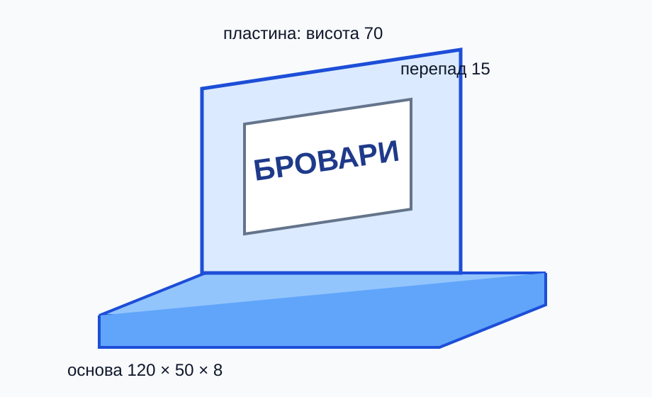

# Урок 15. Спрощений макет стели «Бровари»

## Практична робота № 6

**Спрощений макет стели «Бровари»**

### Тема, час і мета

**Орієнтовний час:** 45 хвилин.

Практична робота № 6 присвячена переходу від фотографій реального об’єкта до спрощеного навчального макета. Учень або учениця має виділити головні геометричні форми, прийняти умовні розміри, побудувати стійку композицію та пояснити, які деталі свідомо не відтворювалися.

Робота не претендує на точну реконструкцію стели або офіційне відтворення її оформлення. Без обмірів і кількох ортогональних зображень справжні розміри визначити неможливо.

### Завдання

За знімком, проаналізованим на [уроці 14](../less-14/README.md), або навчальною схемою нижче побудуйте цілісний макет зі стійкою основою, вертикальною пластиною, скошеним верхом і читабельним написом. Якщо на знімку є підтверджений розмір, використайте калібрований Canvas. Для моделі застосуйте умовні розміри з таблиці.

### Вихідні матеріали

> TODO: додати узгоджені фотографії стели «Бровари» з фронтального й бічного ракурсів, указати автора, джерело та умови використання під кожним зображенням.

Визначте основу, вертикальний знак, ділянку напису, нахили й пропорції. Якщо фотографії ще не надані, проаналізуйте ці елементи за рисунком 1. Дрібні шви, фактура поверхні, кріплення, елементи благоустрою та перспектива не є окремими деталями моделі.

*Рисунок 1. Навчальна схема макета: прямокутна основа, вертикальна пластина зі скошеним верхом і рельєфний напис.*

### Умовні розміри макета

Наведені значення стосуються лише навчальної моделі й не описують фактичні розміри реального об’єкта.

| Елемент | Розмір |
| --- | --- |
| Основа | 120 × 50 × 8 мм |
| Вертикальна пластина | 90 × 12 × 70 мм |
| Нахил верхнього краю | перепад висоти 15 мм |
| Заглиблення панелі | 60 × 35 мм; Cut 1 мм |
| Напис «БРОВАРИ» | висота символів 9–11 мм; виступ 1 мм |
| Скруглення основи | R4 на чотирьох вертикальних ребрах |
| Фаска пластини | 1 мм на доступних зовнішніх ребрах |

Вертикальна пластина має стояти по центру ширини основи. Уздовж довжини її можна змістити на 10 мм назад від центра, щоб перед нею залишився видимий майданчик.

### Послідовність виконання

#### 1. Аналіз і спрощення

Розгляньте фото з різних ракурсів. На окремому аркуші або в ескізі позначте три рівні форми: головні об’єми, помітні декоративні елементи та дрібні деталі. До моделі обов’язково переносяться головні об’єми; декоративні — лише якщо вони впливають на впізнаваність; дрібні деталі пропускаються.

Порівняйте силует із рисунком 1. Якщо фотографія показує іншу важливу пропорцію, збережіть її, але не змінюйте задані габарити основи й загальну висоту без погодження з учителем.

#### 2. Основа макета

Створіть компонент «Стела Бровари — навчальний макет». На площині XY побудуйте центральний прямокутник 120 × 50 мм і витягніть його на 8 мм як **New Body**. Застосуйте Fillet R4 до чотирьох вертикальних ребер.

Перевірте, що нижня грань лишилася плоскою. Макет повинен упевнено стояти на основі, тому не скруглюйте нижній периметр великим радіусом.

#### 3. Вертикальна пластина

На верхній грані основи створіть ескіз прямокутника 90 × 12 мм. Розташуйте його по центру ширини та змістіть на 10 мм назад від центра довжини. Витягніть на 70 мм з операцією **Join**.

Щоб отримати скошений верх, створіть ескіз на широкій бічній грані. Побудуйте трикутний профіль із перепадом висоти 15 мм і виконайте Cut Through All. Назвіть операцію «Нахил верхнього краю».

#### 4. Декоративна панель

На фронтальній грані створіть прямокутник 60 × 35 мм. Вирівняйте його по центру пластини та задайте відступ від нижнього краю. Виконайте заглиблення 1 мм.

Панель є умовним способом передати композицію, а не копією конкретного оздоблення. Її краї мають залишатися всередині фронтальної грані після скошування.

#### 5. Напис

Створіть окремий ескіз на дні заглиблення. Додайте текст «БРОВАРИ» простим напівжирним шрифтом, висотою 9–11 мм. Вирівняйте напис по центру панелі. Витягніть літери на 1 мм з операцією Join: їхня поверхня має бути на рівні фронтальної грані або трохи виступати, залежно від фактичної глибини панелі.

Перевірте літери з внутрішніми областями. Вони не повинні зливатися або виходити за межі панелі. За потреби зменште текстову рамку, а не окремі літери вручну.

#### 6. Завершальна обробка

Застосуйте Chamfer 1 мм до зовнішніх ребер вертикальної пластини, якщо операція не руйнує верхній скіс і напис. Не обробляйте ребра, які зникають у місці з’єднання з основою.

Огляньте макет у фронтальному, бічному та перспективному видах. Перевірте габарити, симетрію, стійкість і цілісність. У браузері має бути одне тіло.

### Що подати на перевірку

- звіт у форматі Markdown або PDF;
- пронумеровані скріншоти аналізу форми, основи, вертикальної пластини, панелі з написом і повного результату.

Під кожним скріншотом потрібен змістовний підпис із назвою виконаної дії, важливими параметрами та отриманим результатом. На останньому скріншоті покажіть повний макет у перспективі. Зазначте, яке джерело використано та які деталі спрощено.

### Типові помилки

- перспективний вигляд фото помилково сприймається як точне креслення;
- до моделі додаються непідтверджені реальні розміри;
- пластина створюється окремим тілом і не з’єднується з основою;
- верхній скіс вирізано не крізь усю товщину;
- текст виходить за межі панелі або має надто тонкі штрихи;
- великі фаски змінюють характерний силует;
- дрібні декоративні деталі відволікають від головних пропорцій.

### Критерії оцінювання

| Критерій | Бали |
| --- | ---: |
| Аналіз і обґрунтоване спрощення форми | 2 |
| Основа та вертикальна пластина заданих розмірів | 3 |
| Нахил, панель і читабельний напис | 3 |
| Цілісність, обробка ребер і перевірка габаритів | 1 |
| Повний звіт із доказами | 2 |
| **Разом за обов’язкові вимоги** | **11** |

12-й бал передбачено за доречний творчий прийом або можливість, якої не розглядали на відповідних уроках. У звіті назвіть прийом, поясніть, чому його не охоплювали відповідні уроки і як він покращив виконання, наведіть номер скріншота. Без текстового обґрунтування творчий бал не нараховується.

### Правила виконання

Виконуйте модель самостійно. Дозволено використовувати матеріали уроків, надані фотографії та офіційну довідку Fusion. Не видавайте умовні розміри макета за фактичні характеристики реальної стели.

## Навігація

[До тематичного плану](../../README.md) · [Попередній урок](../less-14/README.md) · [Наступний урок](../less-16/README.md)
